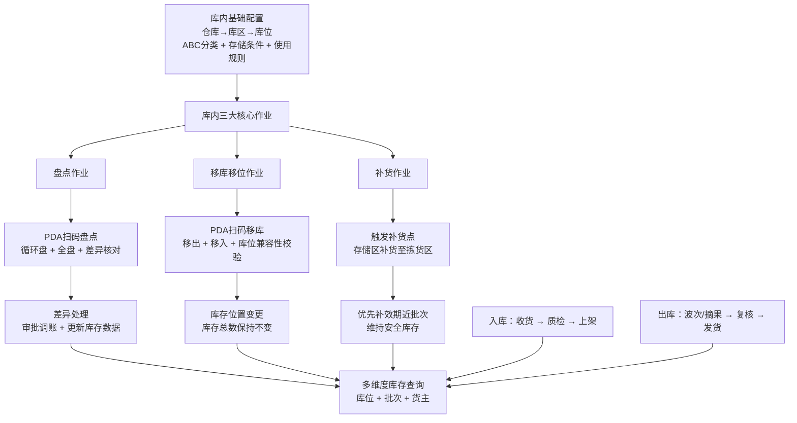
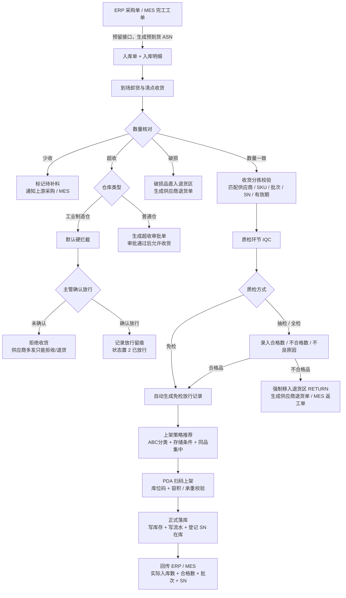
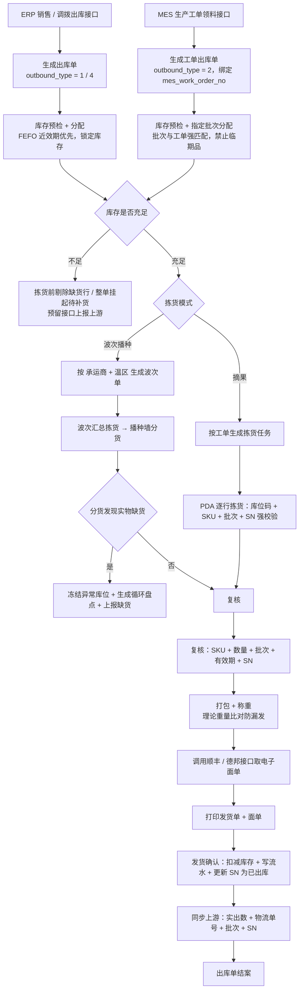
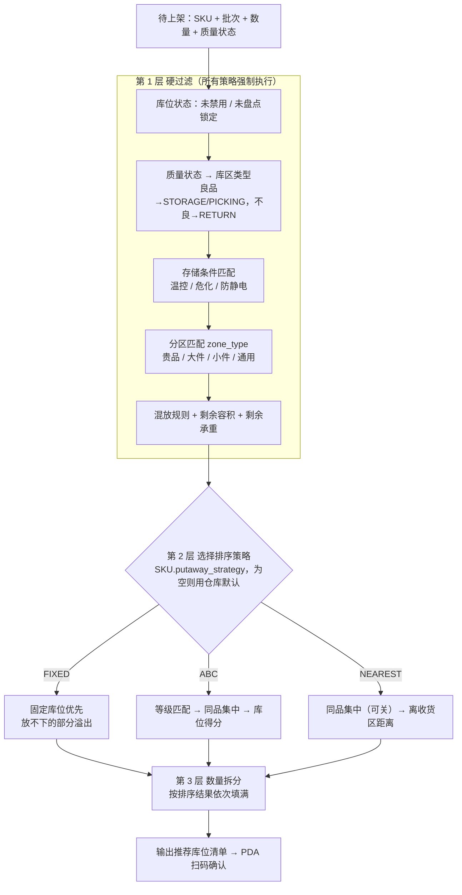
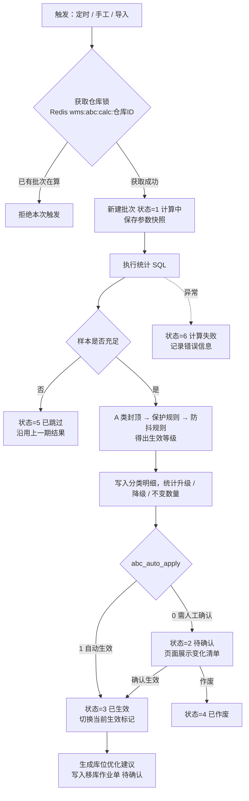

# WMS 整体业务流程规划与数据库演进方案

> 适用工程：`jeecg-module-wms`（JeecgBoot 3.9.5 / Spring Boot 4.1.0 / MyBatis-Plus）
> 数据库现状：MySQL 8.4，库 `jeecg-boot`，已有 28 张 `wms_*` 业务表
> 编写日期：2026-10-28（D1 于同日修订）
> 文档状态：**方案已定稿**（6 项决策见第九章；DDL 已按决策调整并通过临时库校验，尚未对业务库执行）

---

## 一、文档目的与范围

本文档在现有 28 张 WMS 表的基础上，对齐「入库 / 出库 / 库内管理」三条主线业务流程，输出：

1. 现有数据库表的资产盘点与能力诊断；
2. 三大核心流程的状态机、校验规则与异常分支；
3. 表结构缺口清单，以及新增表 / 扩展字段的 DDL 草案；
4. 字典、菜单与模块目录规划；
5. 分期落地路线图与验收要点。

**不在本文档范围内**：ERP / MES / 顺丰 / 德邦接口的具体报文契约（另行输出接口设计文档）、PDA 端页面原型。

---

## 二、现状盘点

### 2.1 表资产总览

| 业务域 | 表名 | 说明 | 数据量（当前） |
| :--- | :--- | :--- | :--- |
| 基础主数据 | `wms_supplier` | 供应商 | 9 |
| | `wms_customer` | 客户（销售侧往来单位） | 36 |
| | `wms_consignor` | 货主（库存归属主体，`consignor_id` 指向它） | 36 |
| | `wms_brand` | 品牌 | 14 |
| | `wms_item_category` | 商品分类（三级树） | 7 |
| | `wms_item_spu` | 商品 SPU | 7 |
| | `wms_item_sku` | 商品 SKU | 19 |
| | `wms_spec` / `wms_product_spec` | 规格 / SKU 规格关联 | 0 |
| | `wms_pcd` | 省市区（另有 `base_province` / `base_city` 在用） | 0 |
| 仓库拓扑 | `wms_warehouse` | 仓库 | 0 |
| | `wms_warehouse_area` | 库区 | 0 |
| | `wms_warehouse_area_loca` | 库位 | 0 |
| 入库作业 | `wms_warehousing_entry` | 入库单 | 0 |
| | `wms_warehousing_entry_details` | 入库明细 | 0 |
| | `wms_warehousing_entry_details_sort` | 入库明细分拣 | 0 |
| | `wms_warehousing_entry_up` | 入库上架 | 0 |
| 出库作业 | `wms_outbound_order` | 出库单 | 0 |
| | `wms_outbound_order_details` | 出库明细 | 0 |
| | `wms_outbound_order_package` | 打包记录 | 0 |
| | `wms_outbound_order_weights` | 称重记录 | 0 |
| 物流 | `wms_logistics_company` | 物流公司 | 0 |
| | `wms_logistics_price` | 物流计费规则 | 0 |
| 库内作业 | `wms_warehouse_operations` | 仓内作业单（加工 / 通用） | 0 |
| | `wms_warehouse_operations_details` | 仓内作业明细 | 0 |
| 盘点 | `wms_stocktaking_task` | 定时盘点任务 | 0 |
| | `wms_stocktaking_task_details` | 盘点任务范围 | 0 |
| | `wms_stocktaking_info` | 盘点记录 | 0 |
| | `wms_stocktaking_loss` | 盘点报损 | 0 |

### 2.2 已有代码覆盖情况

| 模块 | 后端 | 前端 | 菜单 |
| :--- | :--- | :--- | :--- |
| 供应商 | ✅ Controller/Service/Mapper | ✅ `views/wms/WmsSupplier` | ✅ `/wms/base/wmsSupplierList` |
| 品牌 | ✅ | ✅ `views/wms/WmsBrand` | ✅ `/wms/base/wmsBrandList` |
| 商品分类 | ✅ | ✅ `views/wms/WmsItemCategory` | ✅ `/wms/base/wmsItemCategoryList` |
| 商品 SPU / SKU | ✅（含条码、二维码） | ✅ `views/wms/WmsItemSpu` | ✅ `/wms/base/wmsItemSpuList` |
| 客户 | ✅ | ✅ `views/wms/WmsCustomer` | ✅ `/wms/base/wmsCustomerList` |
| 货主 | ✅ | ✅ `views/wms/WmsConsignor` | ✅ `/wms/base/wmsConsignorList` |
| 仓库 / 库区 / 库位 | ❌ | ❌ | ❌ |
| 入库 / 出库 / 库内 / 盘点 | ❌ | ❌ | ❌ |

### 2.3 关键诊断：现有结构的 5 处断层

> 结论先行：**28 张表全部是「单据表」，没有一张「库存表」**。这是当前结构与任何真实 WMS 之间的根本性缺口。

#### 缺口 1：无实时库存表、无库存流水表（阻断性）

- 无法支撑「多维度库存查询（库位 + 批次 + 货主）」；
- 无法支撑出库锁库、取消解锁、FEFO 近效期分配、补货触发、盘点调账；
- 现有入库 `entry_up`（上架表）只记录「某次上架了多少」，无法回答「当前这个库位上还剩多少」。

#### 缺口 2：库位表无法归属库区

`wms_warehouse_area_loca` 现有字段：`loca_code`、`loca_len/width/height`、`local_volume`、`local_bearing_capacity`、`tunnel_number`、`shelf_number`、`layer_number`。

**缺少 `warehouse_id` 与 `warehouse_area_id`**，库位与仓库 / 库区的归属关系无处存放。同时缺少：库位状态、ABC 分类、存储条件、混放规则、已用容积 / 已用承重。

#### 缺口 3：SPU / SKU 缺少作业管控属性

现有 SPU 只有标题、分类、品牌、供应商、长宽高单位；SKU 只有价格、条码、长宽高体积。缺少：ABC 分类、存储条件、质检方式、SN 管理开关、保质期天数、临期禁出天数、拣货区补货上下限。

#### 缺口 4：入库缺少「质检」与「MES 工单」环节

现有链路为：`入库单 → 明细（到货/卸货）→ 分拣 → 上架`，中间没有质检节点；单据上也没有 `erp_po_no`、`mes_work_order_no`、`entry_type`、`entry_code`；明细上也没有批次、生产日期、有效期、质检状态。破损 / 超收 / 少收字段有，但没有对应的审批与退货单承载表。

#### 缺口 5：出库缺少「业务类型」「波次」「批次分配」「复核」

现有出库单只有 `status`（1 预发货 … 9 已签收）与 `customer_id`；无法区分销售出库 / MES 领料 / 采购退货 / 调拨；没有波次概念（无法支撑「订单分波 + 播种分货」）；明细没有分配批次、实拣数、复核状态。

---

## 三、目标业务流程方案

### 3.1 总体架构



核心数据流原则：

1. **所有作业最终都落到 `wms_inventory`**（实时库存）与 `wms_inventory_log`（变动流水）；
2. **单据表只记录「发生了什么」，库存表记录「现在是什么状态」**，二者通过 `biz_no` 关联；
3. **库存数量模型**：`total_count = available_count + locked_count + frozen_count`；
4. **库存维度**：仓库 + 库区 + 库位 + 货主 + SKU + 批次 + 质量状态。

---

### 3.2 入库流程

#### 3.2.1 主流程



#### 3.2.2 状态机（入库单 `wms_warehousing_entry.status`）

| 值 | 状态 | 允许的下一状态 | 说明 |
| :--- | :--- | :--- | :--- |
| 10 | 待到货（ASN） | 20 / 99 | 由 ERP / MES 接口生成 |
| 20 | 收货清点中 | 30 / 90 | 卸货、清点、分拣 |
| 30 | 待质检 | 40 | 收货分拣校验完成 |
| 40 | 质检完成待上架 | 50 | 合格品入待上架池；不合格品已分流 |
| 50 | 上架中 | 60 | 上架任务执行中 |
| 60 | 已完成入库 | — | 库存已落库，已回传上游 |
| 90 | 异常挂起 | 20 / 99 | 少收待补料、超收待审批、SN 不符 |
| 99 | 已取消 | — | 上游撤单 |

> 现有表的 `status` 注释为「1 未确认，2 部分已确认，3 全部确认、4 拣货中、5 已上架」，与上述 10/20/… 编码不一致。**建议统一改为两/三位编码并在字典中维护**，迁移脚本中同步更新注释与默认值。

#### 3.2.3 硬性校验规则

| 编号 | 规则 | 违反时的处理 |
| :--- | :--- | :--- |
| IN-01 | 严格按「收货 → 质检 → 上架」顺序推进，禁止跳步 | 未生成质检记录的明细调用上架接口直接抛业务异常 |
| IN-02 | **工业制造仓**的质检必须绑定 MES 生产工单（`mes_work_order_no` 非空） | 仓型字典为工业仓且入库类型为生产入库时，工单号为空则禁止提交质检；普通仓不校验 |
| IN-03 | 不合格品禁止进入 `STORAGE` / `PICKING` 库位 | 上架目标库位的 `category` 必须是 `RETURN`，否则拦截（全仓型生效） |
| IN-04 | 超收按仓型分级处理 | **工业制造仓**：`surpass_count > 0` 且 `over_receive_audit_status ≠ 2` 时拒绝提交，主管放行后置 2 才允许；**普通仓**：进入超收审批单流程，审批通过后允许（决策 D1 / D4） |
| IN-05 | 上架时校验库位容积与承重 | `已用体积 + 本次体积 > 库位容积` 或 `已用承重 + 本次重量 > 库位承重` 时拒绝 |
| IN-06 | 存储条件必须匹配 | `sku.storage_condition` ≠ 库区 `storage_condition` 时拒绝 |
| IN-07 | SN 码唯一且不重复入库 | `wms_item_sn.sn_code` 命中「在库 / 已出库」状态时拒绝 |
| IN-08 | 少收必须登记待补料 | 提交收货时 `lack_count > 0` 自动生成待补料记录并通知上游 |

---

### 3.3 出库流程

#### 3.3.1 双轨制：波次播种 vs 工单摘果



#### 3.3.2 状态机（出库单 `wms_outbound_order.status`）

| 值 | 状态 | 说明 |
| :--- | :--- | :--- |
| 10 | 待分配 | 单据已生成，未做库存预检 |
| 20 | 已分配 / 已锁库 | 批次已分配，库存进入 `locked_count` |
| 30 | 待补货 | 库存不足，整单或部分行挂起 |
| 40 | 拣货中 | 波次或摘果任务执行中 |
| 50 | 拣货完成待复核 | — |
| 60 | 复核通过待打包 | — |
| 70 | 已打包待发货 | 已获取面单 |
| 80 | 已发货 | 库存已扣减，已回传上游 |
| 90 | 已签收 | 物流回签 |
| 91 | 已取消 | 未发货取消，库存已释放 |
| 92 | 异常挂起 | 缺货、SN 不符、称重超差 |

> 现有编码 1~9 与上述不一致，建议统一为两位编码。若需兼容历史数据，在迁移脚本中做一次映射更新。

#### 3.3.3 异常分支

**缺货**

| 阶段 | 处理策略 |
| :--- | :--- |
| 分配阶段缺货 | 二选一配置：① 剔除缺货行，仅发有货部分，缺货行回传上游拆分；② 整单挂起 `待补货`，触发存储区→拣货区补货任务 |
| 拣货 / 播种阶段账实不符 | 立即冻结该库位 + 自动生成循环盘点任务；同时尝试从其他库位重新分配同批次库存；全仓无货则回调上游缺货异常接口 |

**订单取消**

| 阶段 | 处理策略 |
| :--- | :--- |
| 未拣货（状态 ≤ 20） | 直接释放 `locked_count` → `available_count`，单据置 `已取消` |
| 已拣货未发货（状态 40~70） | 生成「取消返架单」，指引员工将货扫回原库位，库存回到 `available` |
| 已发货（状态 ≥ 80） | 禁止修改原单，必须走逆向销退入库流程（新建销退入库单，重走收货→质检→上架） |

---

### 3.4 库内管理流程

#### 3.4.1 盘点作业

- **触发方式**
  - 循环盘 / 动碰盘（`category = 1`）：按日 / 周对动碰库位、A 类高频商品、拣货异常库位动态抽盘；
  - 全盘 / 计划盘（`category = 2`）：由 `wms_stocktaking_task` 的 Cron 表达式定时生成，按仓库 / 库区 / 库位范围锁库。
- **PDA 扫码盘点**：支持盲盘（不显示 `book_count`，强制录入 `correct_count`），系统计算 `discrepancy_count = correct_count - book_count`。
- **差异处理**
  - 无差异：确认结案，解除库位盘点锁；
  - 有差异：生成损溢记录（扩展 `wms_stocktaking_loss` 支持盘盈），主管审批通过后调整 `wms_inventory`，写入「盘盈 / 盘亏调账」流水，并回传 ERP 财务。

#### 3.4.2 移库移位

- 场景：理货合并、ABC 动销等级调整、不良品移入退货区、温区调整。
- 步骤：扫移出（源库位 + SKU + 批次，锁定数量）→ 扫移入（执行四重兼容性校验）→ 事务内原子扣增。
- **库位兼容性四重校验**：① 目标库位未禁用 / 未盘点锁；② 存储温区匹配；③ 混放策略允许；④ 剩余容积与剩余承重充足。
- 约束：**全仓库存总数严格不变**，仅位置变更，写入移库流水。

#### 3.4.3 补货

- **阈值触发**：拣货区某 SKU 可用库存 < `min_stock` 时生成补货单，数量 = `max_stock - 当前拣货区库存`。
- **波次驱动紧急补货**：分波时拣货区不足但存储区整托有货，生成波次前置补货任务。
- **FEFO 优先**：检索存储区库存按 `expire_date ASC, batch_number ASC` 排序，优先下架效期最近且未进入临期禁出线的批次。

#### 3.4.4 多维库存查询

支持按 仓库 / 库区 / 库位 / 货主 / SKU / 批次 / 质量状态 / 效期状态 / SN 任意组合聚合，并可穿透查询该库存的变动流水。

---

### 3.5 上架策略引擎与 ABC 分类

本节回答两个问题：**货该放哪**（上架策略）和**凭什么这么放**（ABC 分类的统计与公式）。

#### 3.5.1 四种上架策略对比

| 策略 | 原理 | 优点 | 缺点 | 适用场景 |
| :--- | :--- | :--- | :--- | :--- |
| **就近上架**（随机） | 推荐离收货区最近的可用空库位 | 上架效率最高，空间利用率高 | 同一 SKU 分散在多处，不利于批量拣货 | 周转极快、对位置不敏感的商品 |
| **固定库位** | 每个 SKU 预先绑定固定库位 | 员工好记好找，拣货路径稳定 | 空间利用率低；库存激增时容易爆仓 | SKU 少、规格统一、长期稳定的物料 |
| **分区上架** | 按商品属性分到大件区、小件区、贵品区、温控区等 | 最基础，保证物理与安全约束 | 只能定位到区域，不能定位到具体库位 | **所有场景都要用**（见下文） |
| **ABC 驱动** | A 类商品放离拣货/复核区最近、最符合人体工学的库位，C 类放远处或高处 | 拣货路径最短，效率最高 | 依赖历史数据；需要定期重算 | 大多数商品的默认策略 |

**关键设计：这四种策略不是四选一，而是分层组合。**

分区本质上是**约束**（冷藏品绝不能进常温区，大件放不进小格），不是排序偏好，所以它是所有策略共用的前置过滤层。其余三种才是可选的**排序规则**。



- 「纯分区上架」= 分区过滤 + 就近排序（`NEAREST`），不需要单独的策略项；
- 每个 SKU 可单独指定策略（`wms_item_sku.putaway_strategy`），不指定则使用仓库默认值（`wms_strategy_config.putaway_default_strategy`，默认 `ABC`）；
- 第 1 层的任何一条不满足，库位直接排除，**任何策略都不能绕过**。

#### 3.5.2 分区规则（Zoning）

分区分两个维度，分别校验：

| 维度 | 库区字段 | 商品字段 | 匹配规则 |
| :--- | :--- | :--- | :--- |
| 环境条件（温控、危化、防静电） | `wms_warehouse_area.storage_condition` | `wms_item_spu.storage_condition` | 必须相等，不允许降级 |
| 物理与价值（贵品、大件、小件） | `wms_warehouse_area.zone_type` | 由规则推导（见下） | 按推导结果匹配，部分允许兜底 |

**商品分区推导**（按优先级从高到低，命中即停）：

| 顺序 | 分区 | 判定条件（阈值取自 `wms_strategy_config`） |
| :--- | :--- | :--- |
| 1 | `VALUABLE` 贵品 | `spu.is_valuable = 1`，或 `sku.price ≥ zone_valuable_price` |
| 2 | `LARGE` 大件 | 单件体积 ≥ `zone_large_volume`，或单件重量 ≥ `zone_large_weight`，或最长边 ≥ `zone_large_side` |
| 3 | `SMALL` 小件 | 单件体积 ≤ `zone_small_volume` |
| 4 | `GENERAL` 通用 | 以上都不满足 |

**单位换算（必须先做）**：商品的长度、重量、体积单位挂在 SPU 上且各不相同（`length_unit` / `weight_unit` / `volume_unit`），比较阈值前必须统一换算成基准单位：

| 量 | 基准单位 | 换算 |
| :--- | :--- | :--- |
| 长度 | mm | cm ×10，dm ×100，m ×1000 |
| 重量 | g | mg ÷1000，kg ×1000 |
| 体积 | cm³ | dm³ ×1000，m³ ×1,000,000 |

> 现有 `wms_item_sku` 的尺寸、重量字段都是 `int`，如果商品维护时用了大单位（比如 1.5 kg 只能存成 1 或 2），换算后会有误差。**建议商品维护时一律使用最小单位**（mm / g / cm³），这一点需要在商品管理页面加提示。

**找不到对应分区时的兜底**：

| 商品分区 | 允许兜底到 | 理由 |
| :--- | :--- | :--- |
| `VALUABLE` | 不允许 | 安全要求，宁可报「无可用库位」 |
| `LARGE` | 不允许 | 小件区放不下，物理上不可行 |
| `SMALL` | `GENERAL` | 小件放通用区只是浪费一点空间 |
| `GENERAL` | `SMALL`（仍需通过容积校验） | 容积校验会挡住放不下的 |

#### 3.5.3 三种排序策略的具体规则

**库位剩余可放数量**（所有策略共用，用于第 3 层拆分）：

$$
cap_i = \min\left( \left\lfloor \frac{V_i - U^{v}_i}{v} \right\rfloor ,\ \left\lfloor \frac{W_i - U^{w}_i}{w} \right\rfloor \right)
$$

- $V_i$ / $W_i$：库位 $i$ 的容积 / 承重（`local_volume` / `local_bearing_capacity`）
- $U^{v}_i$ / $U^{w}_i$：库位 $i$ 已用体积 / 已用承重（`used_volume` / `used_weight`）
- $v$ / $w$：该 SKU 单件体积 / 重量（换算到基准单位后）

拆分规则：按排序结果依次取库位，每个库位放 $\min(cap_i, 剩余待上架数量)$，直到放完；全部候选放完仍有剩余，则剩余部分标记为「无可用库位」，提示人工处理。

**① FIXED 固定库位**

1. 候选 = `fixed_sku_id = 当前 SKU` 的库位，按 `loca_code` 排序；
2. 固定库位放满后，剩余数量按 `fixed_overflow_strategy`（默认 `ABC`）继续推荐，并在上架记录上标记「溢出」；
3. 固定库位只能放绑定的 SKU，即使空着也不借给别的 SKU（`fixed_loca_lend_when_empty = 0`）。这就是固定库位「空间利用率低」的代价，配置项可以放开，但放开后员工「记得住位置」的优势会打折扣。

**② ABC 驱动（默认策略）**

候选库位按以下顺序逐级排序（前一项相同才比较后一项）：

| 顺序 | 排序项 | 规则 |
| :--- | :--- | :--- |
| 1 | 等级匹配度 | 库位等级 = 商品等级排第一；比商品低一级排第二；低两级排第三。**比商品等级高的库位默认不可用**（C 类商品不能占 A 类库位，`putaway_allow_upgrade_occupy = 0`） |
| 2 | 同品集中 | 已存放同 SKU（不允许混批次时要求同批次）且还有余量的库位优先 |
| 3 | 库位得分 | `loca_score` 降序（离拣货区越近、越符合人体工学，得分越高，见 3.5.4） |
| 4 | 容量贴合 | `cap_i` 与待上架数量越接近越优先，减少一个批次被拆到很多库位 |

第 2 项「同品集中」专门用来解决就近上架「同种商品分散存储」的问题。

**③ NEAREST 就近上架**

| 顺序 | 排序项 | 规则 |
| :--- | :--- | :--- |
| 1 | 同品集中 | 同 ABC 第 2 项，可通过 `putaway_prefer_same_sku = 0` 关闭，变成纯就近 |
| 2 | 离收货区距离 | `receive_distance` 升序 |

**人工偏离**：PDA 扫的库位和系统推荐的不一致时，只要通过第 1 层硬过滤就允许上架，但记录 `is_deviate = 1` 和偏离原因。偏离率是衡量推荐质量的重要指标（见 3.5.7）。

#### 3.5.4 库位 ABC 等级计算

商品 ABC 看「卖得快不快」，库位 ABC 看「好不好拿」。两者配合：A 类商品放进 A 类库位。

**库位得分公式**：

$$
S_i = w_d \cdot \left(1 - \frac{d_i}{d_{max}}\right) + w_e \cdot E_i
$$

| 符号 | 含义 | 数据来源 | 默认值 |
| :--- | :--- | :--- | :--- |
| $d_i$ | 库位到拣货 / 复核区的路径距离（米） | `wms_warehouse_area_loca.pick_distance`，人工维护或 Excel 导入 | — |
| $d_{max}$ | 同仓库参与计算的库位中最大的 $d_i$ | 计算时取 | — |
| $E_i$ | 人体工学系数 | 由 `ergonomic_level` 映射 | 见下表 |
| $w_d$ / $w_e$ | 距离权重 / 人体工学权重，两者之和为 1 | `wms_strategy_config` | 0.6 / 0.4 |

| `ergonomic_level` | 含义 | $E_i$ |
| :--- | :--- | :--- |
| 1 黄金层 | 离地约 0.8～1.5 m（腰部到胸部），不弯腰不踮脚 | 1.0 |
| 2 次优层 | 离地约 0.3～0.8 m 或 1.5～2.0 m | 0.6 |
| 3 不便层 | 地面层、2 m 以上高位、需要登高车或叉车 | 0.2 |

**等级划分**：只有 `STORAGE` / `PICKING` 库区的库位参与计算（收货区、待检区、退货区、集货区不参与）。按 $S_i$ 降序排列：

- 前 `loca_a_ratio`（默认 20%）的库位 → A
- 接下来 `loca_b_ratio`（默认 30%）的库位 → B
- 其余 → C

**计算时机**：库位 ABC 只和仓库布局有关，布局不变就不需要重算。新建库位、调整货架、修改距离数据后，由仓库管理员在「库位管理」页面手工点击「重算库位等级」。计算结果写回 `abc_class` 和 `loca_score`。

#### 3.5.5 商品 ABC 分类计算规则

##### （1）统计口径

| 项目 | 规则 |
| :--- | :--- |
| 计算粒度 | **仓库 + SKU**。同一个商品在不同仓库的动销速度不同，各算各的 |
| 数据来源 | `wms_inventory_log` 中 `biz_type = 2`（出库扣减）的流水，通过 `biz_no` 关联 `wms_outbound_order` |
| 计入的出库类型 | `outbound_type IN (1, 2)`，即销售出库和 MES 工单领料。**采购退货、调拨出库不计入**，它们不代表真实需求 |
| 统计窗口 | 最近 `abc_window_days` 天（默认 90 天），按流水的 `create_time` 判断 |
| 参与计算的 SKU | 窗口内有出库的 SKU，加上当前在该仓库有库存的 SKU |

选择库存流水而不是出库单明细作为数据源，是因为流水的每一行就是「从一个库位拣了一次货」，天然就是拣货次数，而且带准确的时间戳。

##### （2）三个基础指标

对仓库内每个 SKU $i$，在统计窗口内计算：

| 指标 | 公式 | 含义 |
| :--- | :--- | :--- |
| 拣货频次 $f_i$ | 出库扣减流水的行数 | 拣货员为这个 SKU 跑了多少趟 |
| 出库数量 $q_i$ | $\sum \lvert change\_count \rvert$ | 一共出了多少件 |
| 出库金额 $a_i$ | $\sum \lvert change\_count \rvert \times p_i$ | 出了多少钱的货；$p_i$ 取 `sku.price`，为空取 `real_price`，都为空按 0 计并记入批次的「缺失价格数」 |

> **WMS 库位优化应该用「频次」而不是「金额」**。一颗螺丝单价 0.5 元、一年拣 10 万次，按金额是 C 类、按频次是 A 类；一台设备单价 5 万元、一年出 2 次，按金额是 A 类、按频次是 C 类。决定拣货员走多少路的是频次。金额口径更适合财务看资金占用。

##### （3）三种计算模式

由 `abc_calc_mode` 配置，统一用一个得分 $s_i$ 表示：

$$
s_i = w_f \cdot \frac{f_i}{\sum_j f_j} + w_a \cdot \frac{a_i}{\sum_j a_j}
$$

| 模式 | $w_f$ | $w_a$ | 说明 |
| :--- | :--- | :--- | :--- |
| `FREQ` 按频次（**默认**） | 1 | 0 | 适合库位优化 |
| `AMOUNT` 按金额 | 0 | 1 | 适合资金管控 |
| `COMPOSITE` 综合 | `abc_weight_freq`（默认 0.7） | `abc_weight_amount`（默认 0.3） | 两者兼顾，权重之和必须为 1 |

三种模式下 $\sum_i s_i = 1$，所以 $s_i$ 可以直接理解为「该 SKU 占全仓的份额」。

##### （4）累计占比与分级

1. 按 $s_i$ 降序排列（相同时按 $f_i$ 降序，再按 `sku_id` 升序，保证结果稳定可复现）；
2. 计算排第 $k$ 位的 SKU 的累计占比，以及它之前的累计占比：

$$
C_k = \sum_{r=1}^{k} s_{(r)} \qquad\qquad C_{k-1} = C_k - s_{(k)}
$$

3. 分级判定（$\alpha_A$ 默认 0.80，$\alpha_B$ 默认 0.95）：

$$
\text{等级}_k =
\begin{cases}
A, & C_{k-1} < \alpha_A \\
B, & \alpha_A \le C_{k-1} < \alpha_B \\
C, & C_{k-1} \ge \alpha_B
\end{cases}
$$

**用 $C_{k-1}$ 而不是 $C_k$ 判断**，意思是「跨过阈值的那个 SKU 归入较高等级」。这样可以保证 A 类合计份额一定 ≥ 80%，不会因为某个 SKU 刚好跨线而让 A 类覆盖不足。

4. **A 类数量封顶**：当分布比较平均时（工业仓 SKU 少、需求均衡的情况很常见），按累计占比可能有一大半 SKU 都进 A 类，分级就失去意义了。因此限制：

$$
N_A \le \lceil N \times \beta \rceil
$$

$N$ 为参与计算的 SKU 总数，$\beta$ 为 `abc_a_max_sku_ratio`（默认 0.30）。超出部分按排名降为 B 类。

##### （5）兜底与保护规则

公式算出的叫「计算等级」（`calc_class`），经过下面的规则处理后才是「生效等级」（`final_class`）。按顺序执行：

| 顺序 | 规则 | 处理 | 记录的原因 |
| :--- | :--- | :--- | :--- |
| 1 | 样本不足 | 参与 SKU 数 < `abc_min_sku_count`（默认 10），或窗口内总拣货频次为 0 → 整批跳过，沿用上一期结果 | 批次状态 = 5 已跳过 |
| 2 | 人工锁定 | `manual_lock = 1` → 生效等级 = `manual_class`，不参与计算 | `MANUAL_LOCK` |
| 3 | 新品保护 | 首次入库距今 < `abc_new_item_protect_days`（默认 30 天）→ 生效等级 = `abc_new_item_default_class`（默认 B）。新品数据不足，直接算会被误判为 C 类 | `NEW_ITEM` |
| 4 | 窗口内无出库 | 计算等级 = C | — |
| 5 | A 类封顶 | 见上一节 | `A_CAP` |
| 6 | 降级缓冲 | 见 3.5.6 防抖规则 | `DOWN_BUFFER` |

##### （6）计算示例

某仓库 10 个 SKU，90 天窗口内拣货频次合计 1000 次，`FREQ` 模式：

| 排名 | SKU | 频次 $f_i$ | 份额 $s_i$ | 累计 $C_k$ | 之前累计 $C_{k-1}$ | 计算等级 | 封顶后 |
| :---: | :--- | ---: | ---: | ---: | ---: | :---: | :---: |
| 1 | SKU-01 | 400 | 40.0% | 40.0% | 0.0% | A | A |
| 2 | SKU-02 | 250 | 25.0% | 65.0% | 40.0% | A | A |
| 3 | SKU-03 | 120 | 12.0% | 77.0% | 65.0% | A | A |
| 4 | SKU-04 | 80 | 8.0% | 85.0% | 77.0% | A（跨线归高） | **B**（封顶） |
| 5 | SKU-05 | 50 | 5.0% | 90.0% | 85.0% | B | B |
| 6 | SKU-06 | 40 | 4.0% | 94.0% | 90.0% | B | B |
| 7 | SKU-07 | 25 | 2.5% | 96.5% | 94.0% | B（跨线归高） | B |
| 8 | SKU-08 | 20 | 2.0% | 98.5% | 96.5% | C | C |
| 9 | SKU-09 | 10 | 1.0% | 99.5% | 98.5% | C | C |
| 10 | SKU-10 | 5 | 0.5% | 100.0% | 99.5% | C | C |

- SKU-04 的 $C_{k-1} = 77\% < 80\%$，按公式归 A；
- A 类上限 $\lceil 10 \times 0.3 \rceil = 3$，SKU-04 排第 4，降为 B；
- 最终：A 类 3 个（占 SKU 30%，承担 77% 的拣货），B 类 4 个，C 类 3 个。

##### （7）统计 SQL

一条 SQL 同时支持三种模式（通过 $w_f$ / $w_a$ 参数切换），输出每个 SKU 的指标、排名、累计占比和计算等级。A 类封顶和保护规则在 Java 中处理。

```sql
WITH m AS (
    -- 基础指标：拣货频次 / 出库数量 / 出库金额
    SELECT l.sku_id,
           COUNT(*)                                                    AS pick_freq,
           SUM(-l.change_count)                                        AS out_qty,
           SUM(-l.change_count * COALESCE(k.price, k.real_price, 0))   AS out_amount,
           MAX(CASE WHEN k.price IS NULL AND k.real_price IS NULL THEN 1 ELSE 0 END) AS missing_price
    FROM wms_inventory_log l
    JOIN wms_outbound_order o ON o.outbound_code = l.biz_no
                             AND o.outbound_type IN (1, 2)        -- 只计销售出库、MES 领料
    JOIN wms_item_sku k       ON k.id = l.sku_id
    WHERE l.biz_type = 2                                          -- 出库扣减
      AND l.change_count < 0
      AND l.warehouse_id = #{warehouseId}
      AND l.create_time >= #{windowStart}
      AND l.create_time <  #{windowEnd}
    GROUP BY l.sku_id
),
t AS (
    SELECT SUM(pick_freq) AS total_freq, SUM(out_amount) AS total_amount FROM m
),
s AS (
    -- 得分 s_i：先转成高精度小数再除，避免 MySQL 默认只保留 4 位小数导致边界误判
    SELECT m.*,
           #{wFreq}   * COALESCE(CAST(m.pick_freq  AS DECIMAL(24,10)) / NULLIF(t.total_freq,   0), 0)
         + #{wAmount} * COALESCE(CAST(m.out_amount AS DECIMAL(24,10)) / NULLIF(t.total_amount, 0), 0) AS score
    FROM m CROSS JOIN t
),
r AS (
    SELECT s.*,
           ROW_NUMBER() OVER (ORDER BY score DESC, pick_freq DESC, sku_id) AS rank_no,
           SUM(score)   OVER (ORDER BY score DESC, pick_freq DESC, sku_id
                              ROWS BETWEEN UNBOUNDED PRECEDING AND CURRENT ROW) AS cum_score,
           SUM(score)   OVER ()                                               AS total_score
    FROM s
)
SELECT sku_id, pick_freq, out_qty, out_amount, missing_price, score, rank_no,
       cum_score / total_score                 AS cum_ratio,
       (cum_score - score) / total_score       AS prev_cum_ratio,
       CASE WHEN (cum_score - score) / total_score < #{aThreshold} THEN 'A'
            WHEN (cum_score - score) / total_score < #{bThreshold} THEN 'B'
            ELSE 'C' END                       AS calc_class
FROM r
ORDER BY rank_no;
```

> 该 SQL 已在 MySQL 8.4 上用第（6）节的示例数据验证，输出与示例表一致（见第八章）。
>
> 窗口内无出库、但当前有库存的 SKU 不会出现在结果里，由 Java 补齐为 C 类。

#### 3.5.6 重算机制

##### （1）三种触发方式

| 方式 | 触发 | 说明 |
| :--- | :--- | :--- |
| 定时 | Quartz 任务 `WmsAbcCalcJob`，每月 1 日 02:00 | 遍历启用了 ABC 的仓库；距上次生效批次不足 `abc_calc_interval_days`（默认 30 天）的跳过。季度重算只需把间隔改成 90 |
| 手工 | 「ABC 分类分析」页面点击「立即计算」 | 新仓上线、大促前、产品换代后使用 |
| 导入 | Excel 导入初始分类 | **冷启动用**。出库流程（四期）上线前没有流水数据，可导入 ERP 历史出库数据或直接导入人工分类，作为三期上架推荐的依据 |

##### （2）批次状态与流程



- 默认 `abc_auto_apply = 0`：第一次上线时建议人工确认几期，确认结果符合预期后再改成自动生效；
- 生效操作在一个事务里完成：把该仓库原来的 `is_current = 1` 改成 0，本批次明细改成 1；
- 参数快照（`param_snapshot`）保存计算当时的全部配置，事后可以复现任意一期的结果。

##### （3）防抖规则

如果某个 SKU 的份额刚好在阈值附近，每期都可能在 A、B 之间来回跳，导致反复搬货。规则如下：

| 变化方向 | 处理 | 理由 |
| :--- | :--- | :--- |
| 升级（C→B、B→A、C→A） | **立即生效** | 爆款要尽快挪到好位置，晚一个月就多跑一个月冤枉路 |
| 降级（A→B、B→C、A→C） | 连续 `abc_down_confirm_times` 期（默认 2 期）都算出更低等级才生效 | 一次偶然的低谷不值得搬一次货 |

实现方式：每条明细带 `down_pending`（连续降级计数）。新一期计算等级低于上一期生效等级时，`down_pending = 上一期值 + 1`，达到阈值才真正降级并清零；否则沿用上一期生效等级。只要有一期没有降级，计数就清零。

##### （4）库位优化建议

批次生效后，找出「商品等级和所在库位等级不匹配」的 SKU，计算搬过去的收益：

$$
benefit_i = f_i \times \left( \bar{d}_{当前} - d_{目标} \right)
$$

- $\bar{d}_{当前}$：该 SKU 当前所在各库位的 `pick_distance`，按库存数量加权平均；
- $d_{目标}$：按 ABC 策略重新推荐的最佳库位的 `pick_distance`；
- 单位是「米·次」，含义是：按过去一个窗口的拣货频次，搬过去以后能少走多少米。

按 $benefit_i$ 降序，取前 `relocate_max_suggest`（默认 50）条，生成**移库作业单**（`wms_warehouse_operations`，`operation_type = 1` 移库，`source_type = 2` ABC 建议，`status = 1` 未确认）。

**建议只生成不执行**。仓库主管挑选后，在业务低峰期按 3.4.2 的移库流程用 PDA 执行。搬货本身有人力成本，不能因为分类变了就自动大规模搬迁。

##### （5）定时任务注册

任务类放在 WMS 模块：`org.jeecg.modules.wms.job.WmsAbcCalcJob`，参数为仓库 ID，为空表示全部仓库。注册时状态为 `-1`（停止），等出库数据积累满一个窗口后再在「定时任务」页面启用：

```sql
INSERT INTO sys_quartz_job (id, create_by, create_time, del_flag, job_class_name, cron_expression, parameter, description, status)
SELECT '179320000000001', 'admin', NOW(), 0,
       'org.jeecg.modules.wms.job.WmsAbcCalcJob', '0 0 2 1 * ? *', NULL,
       'WMS 商品ABC分类月度重算（参数为仓库ID，为空则全部仓库）', -1
FROM DUAL
WHERE NOT EXISTS (SELECT 1 FROM sys_quartz_job WHERE job_class_name = 'org.jeecg.modules.wms.job.WmsAbcCalcJob');
```

#### 3.5.7 效果度量

| 指标 | 公式 | 目标 |
| :--- | :--- | :--- |
| ABC 库位匹配率 | A 类 SKU 存放在 A 类库位的库存数量 ÷ A 类 SKU 总库存数量 | ≥ 90% |
| 推荐采纳率 | 1 − 偏离推荐的上架次数 ÷ 总上架次数 | ≥ 85%；持续偏低说明距离数据或策略参数需要调整 |
| A 类平均拣货距离 | A 类 SKU 出库流水对应库位 `pick_distance` 的平均值 | 每期对比，应持续下降或保持稳定 |
| 固定库位溢出率 | 标记为溢出的上架次数 ÷ 固定库位策略的上架次数 | 偏高说明固定库位容量设小了 |

#### 3.5.8 默认参数一览（需业务确认）

以下默认值都是行业经验值，全部存在 `wms_strategy_config` 中按仓库配置，上线前请结合实际数据确认：

| 参数 | 默认值 | 参数 | 默认值 |
| :--- | :--- | :--- | :--- |
| `abc_calc_mode` 计算模式 | `FREQ` | `abc_window_days` 统计窗口 | 90 天 |
| `abc_a_threshold` A 类累计阈值 | 0.80 | `abc_b_threshold` B 类累计阈值 | 0.95 |
| `abc_a_max_sku_ratio` A 类数量上限 | 0.30 | `abc_min_sku_count` 最少 SKU 数 | 10 |
| `abc_new_item_protect_days` 新品保护期 | 30 天 | `abc_new_item_default_class` 新品默认等级 | B |
| `abc_down_confirm_times` 降级确认期数 | 2 | `abc_calc_interval_days` 重算间隔 | 30 天 |
| `abc_auto_apply` 自动生效 | 0（人工确认） | `relocate_max_suggest` 每期移库建议上限 | 50 |
| `loca_weight_distance` / `loca_weight_ergo` | 0.6 / 0.4 | `loca_a_ratio` / `loca_b_ratio` | 0.2 / 0.3 |
| `putaway_default_strategy` 默认上架策略 | `ABC` | `putaway_allow_upgrade_occupy` 低等级商品占高等级库位 | 0（不允许） |

---

## 四、表结构演进方案

### 4.1 演进原则

1. **最小侵入**：优先扩展现有 28 张表，不重建；
2. **新增表控制在 8 张**：库存类 `wms_inventory`、`wms_inventory_log`、`wms_item_sn`；作业类 `wms_quality_check`、`wms_wave_order`；策略类 `wms_strategy_config`、`wms_abc_calc_batch`、`wms_abc_class_result`（支撑 3.5 上架策略与 ABC 分类）；
3. **不破坏既有数据**：所有 `ALTER TABLE ... ADD COLUMN` 均允许 `NULL` 或带默认值；
4. **与现有风格一致**：`id` 自增（与 `V20261027_3` 的约定保持一致）、`saas_id`、`create_time/create_by/update_time/update_by`、`is_del`（1 未删除 / 2 已删除）、`utf8mb4_bin`、`ROW_FORMAT=DYNAMIC`。

### 4.2 新增表 DDL 草案

#### 4.2.1 `wms_inventory` — 多维实时库存

```sql
CREATE TABLE `wms_inventory` (
  `id` bigint NOT NULL AUTO_INCREMENT COMMENT '主键ID',
  `warehouse_id` int NOT NULL COMMENT '仓库ID',
  `warehouse_area_id` int NOT NULL COMMENT '库区ID',
  `warehouse_area_loca_id` int NOT NULL COMMENT '库位ID',
  `consignor_id` bigint NOT NULL COMMENT '货主ID',
  `sku_id` bigint NOT NULL COMMENT '规格ID',
  `batch_number` varchar(50) NOT NULL DEFAULT '' COMMENT '批次号',
  `prod_date` date DEFAULT NULL COMMENT '生产日期',
  `expire_date` date DEFAULT NULL COMMENT '有效期至',
  `quality_status` int NOT NULL DEFAULT 1 COMMENT '质量状态(1良品 2待检 3不良品)',
  `total_count` int NOT NULL DEFAULT 0 COMMENT '物理总库存',
  `available_count` int NOT NULL DEFAULT 0 COMMENT '可用库存',
  `locked_count` int NOT NULL DEFAULT 0 COMMENT '锁定库存(出库/移库预占)',
  `frozen_count` int NOT NULL DEFAULT 0 COMMENT '冻结库存(盘点/异常)',
  `used_volume` int NOT NULL DEFAULT 0 COMMENT '占用体积',
  `used_weight` int NOT NULL DEFAULT 0 COMMENT '占用重量',
  `version` int NOT NULL DEFAULT 0 COMMENT '乐观锁版本号',
  `saas_id` varchar(60) DEFAULT NULL COMMENT 'SaaS标识',
  `create_time` datetime NOT NULL COMMENT '创建时间',
  `create_by` varchar(30) DEFAULT NULL COMMENT '创建人账号',
  `update_time` datetime DEFAULT NULL COMMENT '修改时间',
  `update_by` varchar(30) DEFAULT NULL COMMENT '修改人账号',
  `is_del` int DEFAULT 1 COMMENT '是否删除 1未删除 2已删除',
  PRIMARY KEY (`id`),
  UNIQUE KEY `uk_inv_dim` (`warehouse_area_loca_id`,`sku_id`,`batch_number`,`consignor_id`,`quality_status`),
  KEY `idx_inv_sku` (`sku_id`),
  KEY `idx_inv_batch` (`batch_number`),
  KEY `idx_inv_expire` (`expire_date`),
  KEY `idx_inv_wh_area` (`warehouse_id`,`warehouse_area_id`)
) ENGINE=InnoDB DEFAULT CHARSET=utf8mb4 COLLATE=utf8mb4_bin ROW_FORMAT=DYNAMIC COMMENT='多维实时库存表';
```

#### 4.2.2 `wms_inventory_log` — 库存变动流水

```sql
CREATE TABLE `wms_inventory_log` (
  `id` bigint NOT NULL AUTO_INCREMENT COMMENT '主键ID',
  `inventory_id` bigint NOT NULL COMMENT '库存行ID',
  `biz_type` int NOT NULL COMMENT '业务类型(1入库上架 2出库扣减 3移库移出 4移库移入 5补货 6盘点调账 7冻结 8解冻 9锁定 10解锁)',
  `biz_no` varchar(100) DEFAULT NULL COMMENT '关联单号',
  `warehouse_id` int NOT NULL COMMENT '仓库ID',
  `warehouse_area_id` int NOT NULL COMMENT '库区ID',
  `warehouse_area_loca_id` int NOT NULL COMMENT '库位ID',
  `consignor_id` bigint NOT NULL COMMENT '货主ID',
  `sku_id` bigint NOT NULL COMMENT '规格ID',
  `batch_number` varchar(50) NOT NULL DEFAULT '' COMMENT '批次号',
  `change_count` int NOT NULL COMMENT '变动数量(正增负减)',
  `before_count` int NOT NULL COMMENT '变动前数量',
  `after_count` int NOT NULL COMMENT '变动后数量',
  `remark` varchar(255) DEFAULT NULL COMMENT '备注',
  `saas_id` varchar(60) DEFAULT NULL COMMENT 'SaaS标识',
  `create_time` datetime NOT NULL COMMENT '创建时间',
  `create_by` varchar(30) DEFAULT NULL COMMENT '创建人账号',
  PRIMARY KEY (`id`),
  KEY `idx_invlog_inventory` (`inventory_id`),
  KEY `idx_invlog_biz` (`biz_type`,`biz_no`),
  KEY `idx_invlog_sku_batch` (`sku_id`,`batch_number`),
  KEY `idx_invlog_time` (`create_time`)
) ENGINE=InnoDB DEFAULT CHARSET=utf8mb4 COLLATE=utf8mb4_bin ROW_FORMAT=DYNAMIC COMMENT='库存变动流水表';
```

#### 4.2.3 `wms_item_sn` — SN 序列号追踪

```sql
CREATE TABLE `wms_item_sn` (
  `id` bigint NOT NULL AUTO_INCREMENT COMMENT '主键ID',
  `sn_code` varchar(100) NOT NULL COMMENT 'SN序列号',
  `sku_id` bigint NOT NULL COMMENT '规格ID',
  `batch_number` varchar(50) DEFAULT NULL COMMENT '批次号',
  `warehouse_id` int DEFAULT NULL COMMENT '所在仓库ID',
  `warehouse_area_loca_id` int DEFAULT NULL COMMENT '所在库位ID',
  `quality_status` int NOT NULL DEFAULT 1 COMMENT '质量状态(1良品 2待检 3不良品)',
  `entry_order_id` bigint DEFAULT NULL COMMENT '入库单ID',
  `outbound_order_id` bigint DEFAULT NULL COMMENT '出库单ID',
  `mes_work_order_no` varchar(100) DEFAULT NULL COMMENT 'MES生产工单号',
  `status` int NOT NULL DEFAULT 1 COMMENT '状态(1收货待检 2在库良品 3在库不良 4拣货锁定 5已出库 6已退货)',
  `saas_id` varchar(60) DEFAULT NULL COMMENT 'SaaS标识',
  `create_time` datetime NOT NULL COMMENT '创建时间',
  `create_by` varchar(30) DEFAULT NULL COMMENT '创建人账号',
  `update_time` datetime DEFAULT NULL COMMENT '修改时间',
  `update_by` varchar(30) DEFAULT NULL COMMENT '修改人账号',
  `is_del` int DEFAULT 1 COMMENT '是否删除 1未删除 2已删除',
  PRIMARY KEY (`id`),
  UNIQUE KEY `uk_sn_code` (`sn_code`),
  KEY `idx_sn_sku` (`sku_id`,`batch_number`),
  KEY `idx_sn_order` (`entry_order_id`,`outbound_order_id`),
  KEY `idx_sn_mes` (`mes_work_order_no`)
) ENGINE=InnoDB DEFAULT CHARSET=utf8mb4 COLLATE=utf8mb4_bin ROW_FORMAT=DYNAMIC COMMENT='SN序列号追踪表';
```

#### 4.2.4 `wms_quality_check` — 质检单（IQC）

```sql
CREATE TABLE `wms_quality_check` (
  `id` bigint NOT NULL AUTO_INCREMENT COMMENT '主键ID',
  `qc_code` varchar(100) NOT NULL COMMENT '质检单号',
  `warehousing_entry_id` bigint NOT NULL COMMENT '入库单ID',
  `entry_details_id` bigint NOT NULL COMMENT '入库明细ID',
  `mes_work_order_no` varchar(100) DEFAULT NULL COMMENT 'MES生产工单号',
  `sku_id` bigint NOT NULL COMMENT '规格ID',
  `batch_number` varchar(50) DEFAULT NULL COMMENT '批次号',
  `qc_type` int NOT NULL DEFAULT 2 COMMENT '质检方式(1免检 2抽检 3全检)',
  `check_count` int NOT NULL DEFAULT 0 COMMENT '送检数量',
  `sample_count` int NOT NULL DEFAULT 0 COMMENT '抽检数量',
  `pass_count` int NOT NULL DEFAULT 0 COMMENT '合格数量',
  `fail_count` int NOT NULL DEFAULT 0 COMMENT '不合格数量',
  `fail_reason` varchar(255) DEFAULT NULL COMMENT '不合格原因',
  `return_order_no` varchar(100) DEFAULT NULL COMMENT '关联退货单号',
  `qc_emp_id` int DEFAULT NULL COMMENT '质检员工ID',
  `qc_time` datetime DEFAULT NULL COMMENT '质检时间',
  `status` int NOT NULL DEFAULT 1 COMMENT '状态(1待质检 2质检中 3合格 4不合格 5部分合格)',
  `saas_id` varchar(60) DEFAULT NULL COMMENT 'SaaS标识',
  `create_time` datetime NOT NULL COMMENT '创建时间',
  `create_by` varchar(30) DEFAULT NULL COMMENT '创建人账号',
  `update_time` datetime DEFAULT NULL COMMENT '修改时间',
  `update_by` varchar(30) DEFAULT NULL COMMENT '修改人账号',
  `is_del` int DEFAULT 1 COMMENT '是否删除 1未删除 2已删除',
  PRIMARY KEY (`id`),
  UNIQUE KEY `uk_qc_code` (`qc_code`),
  KEY `idx_qc_entry` (`warehousing_entry_id`,`entry_details_id`),
  KEY `idx_qc_mes` (`mes_work_order_no`)
) ENGINE=InnoDB DEFAULT CHARSET=utf8mb4 COLLATE=utf8mb4_bin ROW_FORMAT=DYNAMIC COMMENT='入库质检单表';
```

#### 4.2.5 `wms_wave_order` — 出库波次

```sql
CREATE TABLE `wms_wave_order` (
  `id` bigint NOT NULL AUTO_INCREMENT COMMENT '主键ID',
  `wave_code` varchar(100) NOT NULL COMMENT '波次号',
  `warehouse_id` int NOT NULL COMMENT '仓库ID',
  `pick_mode` int NOT NULL DEFAULT 2 COMMENT '拣货模式(1摘果法 2播种法)',
  `logistics_company_id` bigint DEFAULT NULL COMMENT '承运商ID(分波维度之一)',
  `storage_condition` varchar(30) DEFAULT NULL COMMENT '存储温区(字典 wms_storage_condition，分波维度之一)',
  `order_count` int NOT NULL DEFAULT 0 COMMENT '订单数',
  `sku_count` int NOT NULL DEFAULT 0 COMMENT 'SKU种数',
  `total_count` int NOT NULL DEFAULT 0 COMMENT '总件数',
  `status` int NOT NULL DEFAULT 1 COMMENT '状态(1待拣货 2拣货中 3已拣货 4分货中 5已完成 9已取消)',
  `emp_id` int DEFAULT NULL COMMENT '作业员工ID',
  `saas_id` varchar(60) DEFAULT NULL COMMENT 'SaaS标识',
  `create_time` datetime NOT NULL COMMENT '创建时间',
  `create_by` varchar(30) DEFAULT NULL COMMENT '创建人账号',
  `update_time` datetime DEFAULT NULL COMMENT '修改时间',
  `update_by` varchar(30) DEFAULT NULL COMMENT '修改人账号',
  `is_del` int DEFAULT 1 COMMENT '是否删除 1未删除 2已删除',
  PRIMARY KEY (`id`),
  UNIQUE KEY `uk_wave_code` (`wave_code`),
  KEY `idx_wave_status` (`status`),
  KEY `idx_wave_wh` (`warehouse_id`),
  KEY `idx_wave_group` (`logistics_company_id`,`storage_condition`)
) ENGINE=InnoDB DEFAULT CHARSET=utf8mb4 COLLATE=utf8mb4_bin ROW_FORMAT=DYNAMIC COMMENT='出库波次表';
```

#### 4.2.6 `wms_strategy_config` — 仓库策略参数（支撑 3.5）

键值对结构：`warehouse_id = 0` 为全局默认，某仓库有同名配置时覆盖全局值。这样新增参数只需插一行数据，不用改表结构。

```sql
CREATE TABLE `wms_strategy_config` (
  `id` bigint NOT NULL AUTO_INCREMENT COMMENT '主键ID',
  `warehouse_id` int NOT NULL DEFAULT 0 COMMENT '仓库ID(0为全局默认，仓库级配置覆盖全局)',
  `config_group` varchar(30) NOT NULL COMMENT '参数分组(ABC 商品ABC / LOCA 库位等级 / PUTAWAY 上架 / ZONE 分区)',
  `config_key` varchar(60) NOT NULL COMMENT '参数键',
  `config_value` varchar(255) NOT NULL COMMENT '参数值',
  `remark` varchar(255) DEFAULT NULL COMMENT '参数说明',
  `saas_id` varchar(60) DEFAULT NULL COMMENT 'SaaS标识',
  `create_time` datetime NOT NULL COMMENT '创建时间',
  `create_by` varchar(30) DEFAULT NULL COMMENT '创建人账号',
  `update_time` datetime DEFAULT NULL COMMENT '修改时间',
  `update_by` varchar(30) DEFAULT NULL COMMENT '修改人账号',
  `is_del` int DEFAULT 1 COMMENT '是否删除 1未删除 2已删除',
  PRIMARY KEY (`id`),
  UNIQUE KEY `uk_strategy_wh_key` (`warehouse_id`,`config_key`),
  KEY `idx_strategy_group` (`config_group`)
) ENGINE=InnoDB DEFAULT CHARSET=utf8mb4 COLLATE=utf8mb4_bin ROW_FORMAT=DYNAMIC COMMENT='仓库策略参数表';
```

全局默认参数初始化（与 3.5.8 一致；分区阈值单位为基准单位 mm / g / cm³ / 元）：

```sql
INSERT INTO `wms_strategy_config` (`warehouse_id`,`config_group`,`config_key`,`config_value`,`remark`,`create_time`,`create_by`) VALUES
(0,'ABC','abc_calc_mode','FREQ','计算模式 FREQ频次/AMOUNT金额/COMPOSITE综合',NOW(),'admin'),
(0,'ABC','abc_window_days','90','统计窗口天数',NOW(),'admin'),
(0,'ABC','abc_a_threshold','0.80','A类累计占比阈值',NOW(),'admin'),
(0,'ABC','abc_b_threshold','0.95','B类累计占比阈值',NOW(),'admin'),
(0,'ABC','abc_weight_freq','0.7','综合模式频次权重',NOW(),'admin'),
(0,'ABC','abc_weight_amount','0.3','综合模式金额权重',NOW(),'admin'),
(0,'ABC','abc_a_max_sku_ratio','0.30','A类SKU数量上限占比',NOW(),'admin'),
(0,'ABC','abc_min_sku_count','10','参与计算的最少SKU数，不足则跳过',NOW(),'admin'),
(0,'ABC','abc_new_item_protect_days','30','新品保护天数',NOW(),'admin'),
(0,'ABC','abc_new_item_default_class','B','新品保护期默认等级',NOW(),'admin'),
(0,'ABC','abc_down_confirm_times','2','降级需连续确认期数',NOW(),'admin'),
(0,'ABC','abc_calc_interval_days','30','自动重算最小间隔天数',NOW(),'admin'),
(0,'ABC','abc_auto_apply','0','计算后自动生效 1是 0否',NOW(),'admin'),
(0,'ABC','relocate_max_suggest','50','每期最多生成移库建议条数',NOW(),'admin'),
(0,'LOCA','loca_weight_distance','0.6','库位得分距离权重',NOW(),'admin'),
(0,'LOCA','loca_weight_ergo','0.4','库位得分人体工学权重',NOW(),'admin'),
(0,'LOCA','loca_a_ratio','0.2','A类库位数量占比',NOW(),'admin'),
(0,'LOCA','loca_b_ratio','0.3','B类库位数量占比',NOW(),'admin'),
(0,'PUTAWAY','putaway_default_strategy','ABC','仓库默认上架策略 FIXED/ABC/NEAREST',NOW(),'admin'),
(0,'PUTAWAY','putaway_prefer_same_sku','1','同品集中优先 1是 0否',NOW(),'admin'),
(0,'PUTAWAY','putaway_allow_upgrade_occupy','0','低等级商品可占用高等级库位 1是 0否',NOW(),'admin'),
(0,'PUTAWAY','fixed_overflow_strategy','ABC','固定库位放满后的溢出策略',NOW(),'admin'),
(0,'PUTAWAY','fixed_loca_lend_when_empty','0','固定库位空闲时可借给其他SKU 1是 0否',NOW(),'admin'),
(0,'ZONE','zone_valuable_price','5000','贵品单价阈值(元)',NOW(),'admin'),
(0,'ZONE','zone_large_volume','125000','大件单件体积阈值(cm³，约50×50×50cm)',NOW(),'admin'),
(0,'ZONE','zone_large_weight','25000','大件单件重量阈值(g)',NOW(),'admin'),
(0,'ZONE','zone_large_side','1200','大件最长边阈值(mm)',NOW(),'admin'),
(0,'ZONE','zone_small_volume','1000','小件单件体积阈值(cm³，约10×10×10cm)',NOW(),'admin');
```

#### 4.2.7 `wms_abc_calc_batch` — ABC 计算批次（支撑 3.5.6）

```sql
CREATE TABLE `wms_abc_calc_batch` (
  `id` bigint NOT NULL AUTO_INCREMENT COMMENT '主键ID',
  `batch_code` varchar(50) NOT NULL COMMENT '批次号',
  `warehouse_id` int NOT NULL COMMENT '仓库ID',
  `trigger_type` int NOT NULL DEFAULT 1 COMMENT '触发方式(1定时 2手工 3导入)',
  `calc_mode` varchar(20) NOT NULL DEFAULT 'FREQ' COMMENT '计算模式(FREQ频次 AMOUNT金额 COMPOSITE综合)',
  `window_start` datetime DEFAULT NULL COMMENT '统计窗口开始',
  `window_end` datetime DEFAULT NULL COMMENT '统计窗口结束',
  `param_snapshot` text COMMENT '计算参数快照(JSON)',
  `sku_total` int NOT NULL DEFAULT 0 COMMENT '参与计算SKU数',
  `a_count` int NOT NULL DEFAULT 0 COMMENT 'A类数量',
  `b_count` int NOT NULL DEFAULT 0 COMMENT 'B类数量',
  `c_count` int NOT NULL DEFAULT 0 COMMENT 'C类数量',
  `up_count` int NOT NULL DEFAULT 0 COMMENT '较上期升级数量',
  `down_count` int NOT NULL DEFAULT 0 COMMENT '较上期降级数量',
  `missing_price_count` int NOT NULL DEFAULT 0 COMMENT '缺失价格SKU数(金额口径按0计)',
  `relocate_suggest_count` int NOT NULL DEFAULT 0 COMMENT '生成移库建议条数',
  `status` int NOT NULL DEFAULT 1 COMMENT '状态(1计算中 2待确认 3已生效 4已作废 5已跳过 6计算失败)',
  `error_msg` varchar(500) DEFAULT NULL COMMENT '失败或跳过原因',
  `apply_by` varchar(30) DEFAULT NULL COMMENT '确认生效人',
  `apply_time` datetime DEFAULT NULL COMMENT '生效时间',
  `saas_id` varchar(60) DEFAULT NULL COMMENT 'SaaS标识',
  `create_time` datetime NOT NULL COMMENT '创建时间',
  `create_by` varchar(30) DEFAULT NULL COMMENT '创建人账号',
  `update_time` datetime DEFAULT NULL COMMENT '修改时间',
  `update_by` varchar(30) DEFAULT NULL COMMENT '修改人账号',
  `is_del` int DEFAULT 1 COMMENT '是否删除 1未删除 2已删除',
  PRIMARY KEY (`id`),
  UNIQUE KEY `uk_abc_batch_code` (`batch_code`),
  KEY `idx_abc_batch_wh_status` (`warehouse_id`,`status`)
) ENGINE=InnoDB DEFAULT CHARSET=utf8mb4 COLLATE=utf8mb4_bin ROW_FORMAT=DYNAMIC COMMENT='ABC分类计算批次表';
```

#### 4.2.8 `wms_abc_class_result` — ABC 分类明细（支撑 3.5.5 / 3.5.6）

每个批次每个 SKU 一行，保留计算过程，供追溯、对比和防抖使用。上架推荐通过 `warehouse_id + sku_id + is_current = 1` 读取当前生效等级。

```sql
CREATE TABLE `wms_abc_class_result` (
  `id` bigint NOT NULL AUTO_INCREMENT COMMENT '主键ID',
  `batch_id` bigint NOT NULL COMMENT '计算批次ID',
  `warehouse_id` int NOT NULL COMMENT '仓库ID',
  `sku_id` bigint NOT NULL COMMENT '规格ID',
  `pick_freq` int NOT NULL DEFAULT 0 COMMENT '窗口内拣货频次',
  `out_qty` int NOT NULL DEFAULT 0 COMMENT '窗口内出库数量',
  `out_amount` decimal(16,2) NOT NULL DEFAULT 0.00 COMMENT '窗口内出库金额',
  `score` decimal(12,8) NOT NULL DEFAULT 0 COMMENT '综合得分(全仓份额)',
  `rank_no` int NOT NULL DEFAULT 0 COMMENT '排名',
  `cum_ratio` decimal(10,6) NOT NULL DEFAULT 0 COMMENT '累计占比',
  `calc_class` varchar(2) NOT NULL COMMENT '公式计算等级',
  `prev_class` varchar(2) DEFAULT NULL COMMENT '上期生效等级',
  `final_class` varchar(2) NOT NULL COMMENT '生效等级',
  `adjust_reason` varchar(30) DEFAULT NULL COMMENT '调整原因(MANUAL_LOCK人工锁定 NEW_ITEM新品保护 A_CAP A类封顶 DOWN_BUFFER降级缓冲)',
  `down_pending` int NOT NULL DEFAULT 0 COMMENT '连续降级计数',
  `manual_lock` int NOT NULL DEFAULT 0 COMMENT '人工锁定(1是 0否)',
  `manual_class` varchar(2) DEFAULT NULL COMMENT '人工指定等级',
  `is_current` int NOT NULL DEFAULT 0 COMMENT '是否当前生效(1是 0否)',
  `saas_id` varchar(60) DEFAULT NULL COMMENT 'SaaS标识',
  `create_time` datetime NOT NULL COMMENT '创建时间',
  `create_by` varchar(30) DEFAULT NULL COMMENT '创建人账号',
  `update_time` datetime DEFAULT NULL COMMENT '修改时间',
  `update_by` varchar(30) DEFAULT NULL COMMENT '修改人账号',
  PRIMARY KEY (`id`),
  UNIQUE KEY `uk_abc_result_batch_sku` (`batch_id`,`sku_id`),
  KEY `idx_abc_result_current` (`warehouse_id`,`sku_id`,`is_current`)
) ENGINE=InnoDB DEFAULT CHARSET=utf8mb4 COLLATE=utf8mb4_bin ROW_FORMAT=DYNAMIC COMMENT='ABC分类明细表';
```

> **为什么等级存明细表而不是只存 `wms_item_spu.abc_class`**：
> 1. 等级应该按「仓库 + SKU」计算，而 SPU 字段是全局唯一的，无法区分不同仓库；
> 2. 同一 SPU 下不同规格（SKU）的动销差异可能很大。
>
> 因此 `wms_item_spu.abc_class` 改为「**初始等级 / 兜底等级**」：用于冷启动、新品、以及某仓库还没有任何生效批次的情况。上架推荐取等级的优先级为：明细表当前生效等级 → `spu.abc_class` → 新品默认等级 B。

### 4.3 现有表扩展 DDL 草案

#### 4.3.1 库位表补齐归属与使用规则

```sql
ALTER TABLE `wms_warehouse_area_loca`
  ADD COLUMN `warehouse_id` int NULL COMMENT '所属仓库ID' AFTER `id`,
  ADD COLUMN `warehouse_area_id` int NULL COMMENT '所属库区ID' AFTER `warehouse_id`,
  ADD COLUMN `abc_class` varchar(2) NULL COMMENT 'ABC分类 A/B/C' AFTER `layer_number`,
  ADD COLUMN `storage_condition` varchar(30) NULL COMMENT '存储条件(字典 wms_storage_condition)' AFTER `abc_class`,
  ADD COLUMN `loca_status` int NOT NULL DEFAULT 1 COMMENT '库位状态(1空闲 2占用 3盘点锁定 4禁用)' AFTER `storage_condition`,
  ADD COLUMN `allow_mix_sku` int NOT NULL DEFAULT 0 COMMENT '是否允许混SKU(1是 0否)' AFTER `loca_status`,
  ADD COLUMN `allow_mix_batch` int NOT NULL DEFAULT 1 COMMENT '是否允许混批次(1是 0否)' AFTER `allow_mix_sku`,
  ADD COLUMN `used_volume` int NOT NULL DEFAULT 0 COMMENT '已用体积' AFTER `allow_mix_batch`,
  ADD COLUMN `used_weight` int NOT NULL DEFAULT 0 COMMENT '已用承重' AFTER `used_volume`,
  ADD COLUMN `pick_distance` int NULL COMMENT '到拣货/复核区路径距离(米)，用于库位得分' AFTER `used_weight`,
  ADD COLUMN `receive_distance` int NULL COMMENT '到收货区路径距离(米)，用于就近上架' AFTER `pick_distance`,
  ADD COLUMN `ergonomic_level` int NOT NULL DEFAULT 2 COMMENT '人体工学层级(1黄金层 2次优层 3不便层)' AFTER `receive_distance`,
  ADD COLUMN `loca_score` decimal(6,4) NULL COMMENT '库位得分(越高越好取)，由库位等级计算回写' AFTER `ergonomic_level`,
  ADD COLUMN `fixed_sku_id` bigint NULL COMMENT '固定库位绑定的SKU，为空表示非固定库位' AFTER `loca_score`,
  ADD KEY `idx_loca_wh_area` (`warehouse_id`,`warehouse_area_id`),
  ADD KEY `idx_loca_status` (`loca_status`),
  ADD KEY `idx_loca_fixed_sku` (`fixed_sku_id`);
```

> `abc_class`（库位等级）由 3.5.4 的公式计算回写，也允许人工修改；人工修改后在下一次「重算库位等级」时会被覆盖，需要固定的库位请改用 `fixed_sku_id`。

#### 4.3.2 库区补充存储条件

```sql
ALTER TABLE `wms_warehouse_area`
  ADD COLUMN `storage_condition` varchar(30) NULL COMMENT '存储条件(字典 wms_storage_condition)' AFTER `category`,
  ADD COLUMN `abc_class` varchar(2) NULL COMMENT 'ABC分类 A/B/C' AFTER `storage_condition`,
  ADD COLUMN `zone_type` varchar(30) NOT NULL DEFAULT 'GENERAL' COMMENT '分区类型(字典 wms_zone_type：GENERAL通用 SMALL小件 LARGE大件 VALUABLE贵品)' AFTER `abc_class`;
```

> `category` 已有列（字典数据），建议字典 `wms_warehouse_area_category` 取值：`RECEIVING` 收货暂存、`QC` 待检、`STORAGE` 存储、`PICKING` 拣货、`RETURN` 退货/不良品、`SHIPPING` 集货待发。

#### 4.3.3 仓库补充作业类型

```sql
ALTER TABLE `wms_warehouse`
  ADD COLUMN `warehouse_type` varchar(30) NOT NULL DEFAULT 'NORMAL' COMMENT '仓库类型(字典 wms_warehouse_type：NORMAL 普通仓 / INDUSTRIAL 工业制造仓)' AFTER `name`,
  ADD COLUMN `manager_phone` varchar(20) NULL COMMENT '负责人电话' AFTER `person_charge_id`,
  ADD COLUMN `enable_status` int NOT NULL DEFAULT 1 COMMENT '启用状态(1启用 0停用)' AFTER `sort`;
```

> 决策 D1：**工业仓与普通仓共存**，仓型由字典 `wms_warehouse_type` 驱动（`NORMAL` / `INDUSTRIAL`），不使用硬编码整数。
>
> | 强规则 | NORMAL 普通仓 | INDUSTRIAL 工业制造仓 |
> | :--- | :--- | :--- |
> | 超收 | 走超收审批单，审批通过可收 | 默认硬拦截，主管显式放行才可收 |
> | 质检绑定 MES 工单 | 不校验 | 强制校验 `mes_work_order_no` |
> | 出库模式 | 波次播种（可配置） | 按 MES 工单摘果，批次强匹配 |
> | 临期禁出 | 按商品 `near_expire_days` | 同左，且工单批次不符直接拒绝 |
>
> 所有强规则判断统一走 `WmsWarehouseTypeEnum`（见 4.5 节），禁止在业务代码中出现 `warehouse_type == 2` 这类魔法值比较。

#### 4.3.4 SPU 扩展作业属性

```sql
ALTER TABLE `wms_item_spu`
  ADD COLUMN `abc_class` varchar(2) NULL COMMENT '初始/兜底ABC等级(实际生效等级见 wms_abc_class_result)' AFTER `supplier_id`,
  ADD COLUMN `storage_condition` varchar(30) NULL COMMENT '存储条件(字典 wms_storage_condition)' AFTER `abc_class`,
  ADD COLUMN `is_valuable` int NOT NULL DEFAULT 0 COMMENT '是否贵品(1是 0否)，用于分区推导' AFTER `storage_condition`,
  ADD COLUMN `is_shelf_life` int NOT NULL DEFAULT 0 COMMENT '是否效期管理(1是 0否)' AFTER `is_valuable`,
  ADD COLUMN `shelf_life_days` int NULL COMMENT '保质期天数' AFTER `is_shelf_life`,
  ADD COLUMN `near_expire_days` int NULL COMMENT '临期禁出阈值天数（决策 D5：按商品配置，仓库不设全局值）' AFTER `shelf_life_days`;
```

#### 4.3.5 SKU 扩展作业属性

```sql
ALTER TABLE `wms_item_sku`
  ADD COLUMN `qc_type` int NOT NULL DEFAULT 2 COMMENT '默认质检方式(1免检 2抽检 3全检)' AFTER `code`,
  ADD COLUMN `is_sn_managed` int NOT NULL DEFAULT 0 COMMENT '是否SN管理(1是 0否，决策 D2：按商品开关)' AFTER `qc_type`,
  ADD COLUMN `min_stock` int NOT NULL DEFAULT 0 COMMENT '拣货区补货触发下限' AFTER `is_sn_managed`,
  ADD COLUMN `max_stock` int NOT NULL DEFAULT 0 COMMENT '拣货区最大安全库存' AFTER `min_stock`,
  ADD COLUMN `putaway_strategy` varchar(20) NULL COMMENT '上架策略(FIXED固定 ABC驱动 NEAREST就近)，为空用仓库默认' AFTER `max_stock`;
```

#### 4.3.5.1 入库上架表记录推荐与偏离

```sql
ALTER TABLE `wms_warehousing_entry_up`
  ADD COLUMN `batch_number` varchar(50) NULL COMMENT '批次号' AFTER `sku_id`,
  ADD COLUMN `strategy_used` varchar(20) NULL COMMENT '本次使用的上架策略(FIXED/ABC/NEAREST)' AFTER `count`,
  ADD COLUMN `recommend_loca_id` int NULL COMMENT '系统推荐库位ID' AFTER `strategy_used`,
  ADD COLUMN `is_deviate` int NOT NULL DEFAULT 0 COMMENT '是否偏离推荐(1是 0否)' AFTER `recommend_loca_id`,
  ADD COLUMN `deviate_reason` varchar(255) NULL COMMENT '偏离原因' AFTER `is_deviate`,
  ADD COLUMN `is_overflow` int NOT NULL DEFAULT 0 COMMENT '是否固定库位溢出(1是 0否)' AFTER `deviate_reason`;
```

#### 4.3.6 入库单扩展

```sql
ALTER TABLE `wms_warehousing_entry`
  ADD COLUMN `entry_code` varchar(100) NULL COMMENT '入库单号' AFTER `id`,
  ADD COLUMN `entry_type` int NOT NULL DEFAULT 1 COMMENT '入库类型(1采购入库 2MES生产入库 3销退入库 4调拨入库)' AFTER `entry_code`,
  ADD COLUMN `erp_po_no` varchar(100) NULL COMMENT '上游ERP采购单号' AFTER `entry_type`,
  ADD COLUMN `mes_work_order_no` varchar(100) NULL COMMENT 'MES生产工单号' AFTER `erp_po_no`,
  ADD COLUMN `over_receive_audit_status` int NOT NULL DEFAULT 0 COMMENT '超收放行状态(0无需放行 1待主管确认 2已放行 3已驳回，决策 D4)' AFTER `surpass_count`,
  ADD COLUMN `wait_supplement_flag` int NOT NULL DEFAULT 0 COMMENT '少收待补料标识(0否 1是)' AFTER `lack_count`,
  ADD UNIQUE KEY `uk_entry_code` (`entry_code`),
  ADD KEY `idx_entry_mes` (`mes_work_order_no`);
```

#### 4.3.7 入库明细扩展

```sql
ALTER TABLE `wms_warehousing_entry_details`
  ADD COLUMN `batch_number` varchar(50) NULL COMMENT '批次号' AFTER `sku_id`,
  ADD COLUMN `prod_date` date NULL COMMENT '生产日期' AFTER `batch_number`,
  ADD COLUMN `expire_date` date NULL COMMENT '有效期至' AFTER `prod_date`,
  ADD COLUMN `received_count` int NOT NULL DEFAULT 0 COMMENT '实收数量' AFTER `count`,
  ADD COLUMN `qc_status` int NOT NULL DEFAULT 1 COMMENT '质检状态(1待质检 2质检中 3合格 4不合格 5部分合格)' AFTER `status`,
  ADD COLUMN `qc_pass_count` int NOT NULL DEFAULT 0 COMMENT '质检合格数' AFTER `qc_status`,
  ADD COLUMN `qc_fail_count` int NOT NULL DEFAULT 0 COMMENT '质检不合格数' AFTER `qc_pass_count`;
```

#### 4.3.8 出库单扩展

```sql
ALTER TABLE `wms_outbound_order`
  ADD COLUMN `outbound_code` varchar(100) NULL COMMENT '出库单号' AFTER `id`,
  ADD COLUMN `outbound_type` int NOT NULL DEFAULT 1 COMMENT '出库类型(1销售出库 2MES工单领料 3采购退货 4调拨出库)' AFTER `outbound_code`,
  ADD COLUMN `pick_mode` int NOT NULL DEFAULT 1 COMMENT '拣货模式(1摘果法 2波次播种法)' AFTER `outbound_type`,
  ADD COLUMN `wave_id` bigint NULL COMMENT '波次ID' AFTER `pick_mode`,
  ADD COLUMN `erp_order_no` varchar(100) NULL COMMENT '上游ERP单号' AFTER `wave_id`,
  ADD COLUMN `mes_work_order_no` varchar(100) NULL COMMENT 'MES生产工单号' AFTER `erp_order_no`,
  ADD UNIQUE KEY `uk_outbound_code` (`outbound_code`),
  ADD KEY `idx_outbound_wave` (`wave_id`),
  ADD KEY `idx_outbound_mes` (`mes_work_order_no`);
```

#### 4.3.9 出库明细扩展

```sql
ALTER TABLE `wms_outbound_order_details`
  ADD COLUMN `batch_number` varchar(50) NULL COMMENT '分配批次号' AFTER `sku_id`,
  ADD COLUMN `expire_date` date NULL COMMENT '有效期至' AFTER `batch_number`,
  ADD COLUMN `allocated_count` int NOT NULL DEFAULT 0 COMMENT '已分配数量' AFTER `out_count`,
  ADD COLUMN `picked_count` int NOT NULL DEFAULT 0 COMMENT '实拣数量' AFTER `allocated_count`,
  ADD COLUMN `review_count` int NOT NULL DEFAULT 0 COMMENT '复核数量' AFTER `picked_count`,
  ADD COLUMN `review_status` int NOT NULL DEFAULT 0 COMMENT '复核状态(0未复核 1通过 2不通过)' AFTER `review_count`,
  ADD COLUMN `shortage_handle` int NOT NULL DEFAULT 1 COMMENT '缺货处理(1剔除缺货行 2整单挂起)' AFTER `review_status`;
```

#### 4.3.10 库内作业明细与盘点扩展

```sql
ALTER TABLE `wms_warehouse_operations`
  ADD COLUMN `operation_type` int NOT NULL DEFAULT 1 COMMENT '作业子类(1移库移位 2补货 3加工 4取消返架)' AFTER `category`,
  ADD COLUMN `source_type` int NOT NULL DEFAULT 1 COMMENT '来源(1人工创建 2ABC优化建议 3系统补货)' AFTER `operation_type`,
  ADD COLUMN `source_batch_id` bigint NULL COMMENT '来源ABC计算批次ID' AFTER `source_type`;

ALTER TABLE `wms_warehouse_operations_details`
  ADD COLUMN `batch_number` varchar(50) NULL COMMENT '批次号' AFTER `sku_id`,
  ADD COLUMN `consignor_id` bigint NULL COMMENT '货主ID' AFTER `batch_number`,
  ADD COLUMN `source_warehouse_area_id` int NULL COMMENT '来源库区ID' AFTER `target_count`,
  ADD COLUMN `source_warehouse_area_loca_id` int NULL COMMENT '来源库位ID' AFTER `source_warehouse_area_id`;

ALTER TABLE `wms_stocktaking_info`
  ADD COLUMN `consignor_id` bigint NULL COMMENT '货主ID' AFTER `sku_id`,
  ADD COLUMN `batch_number` varchar(50) NULL COMMENT '批次号' AFTER `consignor_id`,
  ADD COLUMN `expire_date` date NULL COMMENT '有效期至' AFTER `batch_number`,
  ADD COLUMN `audit_status` int NOT NULL DEFAULT 0 COMMENT '差异审批状态(0无差异 1待审批 2已通过 3已驳回)' AFTER `discrepancy_count`,
  ADD COLUMN `audit_by` varchar(30) NULL COMMENT '审批人' AFTER `audit_status`,
  ADD COLUMN `audit_time` datetime NULL COMMENT '审批时间' AFTER `audit_by`;
```

#### 4.3.11 盘点报损补充盘盈

```sql
ALTER TABLE `wms_stocktaking_loss`
  ADD COLUMN `loss_type` int NOT NULL DEFAULT 1 COMMENT '损溢类型(1盘亏 2盘盈)' AFTER `loss_category`,
  ADD COLUMN `batch_number` varchar(50) NULL COMMENT '批次号' AFTER `stocktaking_info`;
```

> 现有列名 `stocktaking_info` 语义为「盘点信息ID」，与表名重名，建议后续重命名为 `stocktaking_info_id`（重命名需同步改代码，本期可先保留）。

### 4.4 变更风险与执行顺序

**建议执行顺序**（每步独立可回滚）：

1. `ALTER` 库位 / 库区 / 仓库（无依赖）；
2. `ALTER` SPU / SKU（无依赖）；
3. `CREATE` `wms_inventory` / `wms_inventory_log` / `wms_item_sn`；
4. `CREATE` `wms_quality_check` / `wms_wave_order`；
5. `CREATE` `wms_strategy_config` / `wms_abc_calc_batch` / `wms_abc_class_result`，并初始化全局默认参数；
6. `ALTER` 入库单 / 明细 / 上架表；
7. `ALTER` 出库单 / 明细；
8. `ALTER` 库内作业 / 盘点 / 报损；
9. 字典、定时任务（`WmsAbcCalcJob`，状态为停止）初始化；**菜单延后**——按既有做法，菜单随各期 CRUD 页面上线时同批提交（见 8.1）。

**注意事项**：

- `wms_warehousing_entry.batch_number` 与新增的明细 `batch_number` 存在语义重叠（单头批次 vs 行批次）。建议**单头保留兼容，新逻辑以明细行为准**，后续单头批次字段标记废弃。
- `wms_outbound_order_details.target_warehouse_id / target_warehouse_area_id / target_warehouse_area_loca_id` 命名中的 `target_` 语义来自调拨（目标仓），销售出库时实际是「来源仓」。建议新代码统一理解为「分配库位」，字段名暂不改，在实体注释中说明。
- 所有新增 `NOT NULL` 列均带 `DEFAULT`，存量空表无风险；若生产库已有数据，需先 `UPDATE` 回填再收紧约束。
- `wms_inventory` 的唯一键含 `batch_number` 与 `quality_status`，若后续允许「同库位同批次不同效期」，需把 `expire_date` 并入唯一键。
- `wms_warehouse.warehouse_type` 使用字符串字典值（`NORMAL` / `INDUSTRIAL`）而非整数，便于后续扩展第三种仓型时不产生编码含义歧义；存量空表无回填成本。

### 4.5 仓型枚举与规则判定（决策 D1 落地方式）

仓型以字典 `wms_warehouse_type` 承载，代码侧用枚举收敛，**禁止散落的魔法值比较**：

```java
package org.jeecg.modules.wms.enums;

/**
 * 仓库类型。与字典 wms_warehouse_type 的 item_value 一一对应。
 */
public enum WmsWarehouseTypeEnum {

    /** 普通仓：允许超收审批、不强制绑定 MES 工单 */
    NORMAL("NORMAL", "普通仓"),

    /** 工业制造仓：超收默认拦截、质检必须绑定 MES 工单、按工单摘果出库 */
    INDUSTRIAL("INDUSTRIAL", "工业制造仓");

    private final String code;
    private final String desc;

    WmsWarehouseTypeEnum(String code, String desc) {
        this.code = code;
        this.desc = desc;
    }

    public String getCode() { return code; }
    public String getDesc() { return desc; }

    public static WmsWarehouseTypeEnum of(String code) {
        for (WmsWarehouseTypeEnum e : values()) {
            if (e.code.equals(code)) {
                return e;
            }
        }
        throw new IllegalArgumentException("未知仓库类型: " + code);
    }

    /** 是否强校验 MES 生产工单 */
    public boolean requireMesWorkOrder() {
        return this == INDUSTRIAL;
    }

    /** 超收默认是否硬拦截（普通仓走审批单，不硬拦截） */
    public boolean hardBlockOverReceive() {
        return this == INDUSTRIAL;
    }
}
```

**调用约束**：

- 服务层统一通过 `WmsWarehouseTypeEnum.of(warehouse.getWarehouseType())` 取枚举，再调 `requireMesWorkOrder()` / `hardBlockOverReceive()` 判定；
- 新增第三种仓型（如冷链仓 `COLD_CHAIN`）时，只需扩展字典项与枚举，两处判定方法各自给出默认实现；
- 前端下拉直接绑定字典 `wms_warehouse_type`，无需硬编码选项；
- 仓型为 `null` 的历史数据按 `NORMAL` 兜底，避免升级期间空指针。

---

## 五、字典与菜单规划

### 5.1 字典（当前库中无任何 `wms_*` 字典，需全部新建）

| 字典编码 | 名称 | 取值 |
| :--- | :--- | :--- |
| `wms_warehouse_type` | 仓库类型 | NORMAL 普通仓 / INDUSTRIAL 工业制造仓（决策 D1，字符串值，扩展新仓型不影响存量） |
| `wms_warehouse_area_category` | 库区类型 | RECEIVING 收货暂存 / QC 待检 / STORAGE 存储 / PICKING 拣货 / RETURN 退货不良 / SHIPPING 集货待发 |
| `wms_loca_status` | 库位状态 | 1空闲 2占用 3盘点锁定 4禁用 |
| `wms_abc_class` | ABC分类 | A / B / C |
| `wms_storage_condition` | 存储条件 | 常温 / 阴凉 / 冷藏 / 冷冻 / 防静电 / 危化 |
| `wms_qc_type` | 质检方式 | 1免检 2抽检 3全检 |
| `wms_qc_status` | 质检状态 | 1待质检 2质检中 3合格 4不合格 5部分合格 |
| `wms_entry_type` | 入库类型 | 1采购入库 2MES生产入库 3销退入库 4调拨入库 |
| `wms_outbound_type` | 出库类型 | 1销售出库 2MES工单领料 3采购退货 4调拨出库 |
| `wms_pick_mode` | 拣货模式 | 1摘果法 2波次播种法 |
| `wms_operation_type` | 库内作业子类 | 1移库移位 2补货 3加工 4取消返架 |
| `wms_quality_status` | 库存质量状态 | 1良品 2待检 3不良品 |
| `wms_sn_status` | SN状态 | 1收货待检 2在库良品 3在库不良 4拣货锁定 5已出库 6已退货 |
| `wms_inventory_biz_type` | 库存变动类型 | 1入库上架 2出库扣减 3移库移出 4移库移入 5补货 6盘点调账 7冻结 8解冻 9锁定 10解锁 |
| `wms_zone_type` | 分区类型 | GENERAL 通用 / SMALL 小件 / LARGE 大件 / VALUABLE 贵品 |
| `wms_putaway_strategy` | 上架策略 | FIXED 固定库位 / ABC ABC驱动 / NEAREST 就近上架 |
| `wms_ergonomic_level` | 人体工学层级 | 1黄金层 2次优层 3不便层 |
| `wms_abc_calc_mode` | ABC计算模式 | FREQ 按频次 / AMOUNT 按金额 / COMPOSITE 综合 |
| `wms_abc_batch_status` | ABC批次状态 | 1计算中 2待确认 3已生效 4已作废 5已跳过 6计算失败 |
| `wms_abc_trigger_type` | ABC触发方式 | 1定时 2手工 3导入 |
| `wms_abc_adjust_reason` | ABC调整原因 | MANUAL_LOCK 人工锁定 / NEW_ITEM 新品保护 / A_CAP A类封顶 / DOWN_BUFFER 降级缓冲 |
| `wms_operation_source` | 库内作业来源 | 1人工创建 2ABC优化建议 3系统补货 |

### 5.2 菜单规划

现有菜单树：

```
wms (0)
└── 基础数据 /wms/base (1)
    ├── 供应商信息
    ├── 商品类别设置
    ├── 品牌管理
    ├── 商品管理
    └── 客户信息
```

规划后（建议在 `wms` 下新增 4 个一级子菜单）：

```
wms
├── 基础数据      /wms/base
│   ├── 供应商信息
│   ├── 商品类别设置
│   ├── 品牌管理
│   ├── 商品管理
│   └── 客户信息
├── 仓储管理      /wms/warehouse
│   ├── 仓库管理
│   ├── 库区管理
│   ├── 库位管理（含「重算库位等级」按钮）
│   └── 策略参数配置
├── 入库管理      /wms/inbound
│   ├── 入库单
│   ├── 收货作业
│   ├── 质检单
│   └── 上架作业
├── 出库管理      /wms/outbound
│   ├── 出库单
│   ├── 波次管理
│   ├── 拣货任务
│   ├── 复核打包
│   └── 物流发货
└── 库存管理      /wms/stock
    ├── 实时库存
    ├── 库存流水
    ├── 移库移位
    ├── 补货作业
    ├── 盘点管理
    ├── SN追溯
    └── ABC分类分析（批次列表 / 变化清单 / 确认生效 / 人工锁定）
```

前端目录与后端包结构同步：

```
jeecgboot-vue3/src/views/wms/
  WmsWarehouse/  WmsWarehouseArea/  WmsWarehouseLoca/  WmsStrategyConfig/
  WmsInbound/  WmsQualityCheck/  WmsOutbound/  WmsWave/
  WmsInventory/  WmsInventoryLog/  WmsMove/  WmsReplenish/
  WmsStocktaking/  WmsItemSn/  WmsAbcAnalysis/
```

---

## 六、分期落地路线图

| 期次 | 内容 | 交付物 | 前置依赖 |
| :--- | :--- | :--- | :--- |
| **一期：地基** | 执行全部 DDL；字典初始化；仓库 / 库区 / 库位三个基础模块（含存储条件、分区、距离与人体工学数据维护，**库位等级计算**）；策略参数配置；商品 WMS 属性扩展 | Flyway 脚本 + 4 个 CRUD 模块 + 菜单 | 无 |
| **二期：库存底座** | 多维库存查询、库存流水、SN 追溯；移库移位、补货、盘点（含差异审批调账） | 库存中心 + 3 个库内作业模块 | 一期 |
| **三期：入库闭环** | 收货清点（单货匹配、少收待补料、超收拦截/审批、破损退货）、IQC 质检、**上架策略引擎（分区过滤 + 固定 / ABC / 就近）**、容积承重校验、落库与回传；ABC 冷启动导入 | 入库全链路 + 质检单 + 上架推荐 | 二期 |
| **四期：出库闭环** | 库存分配与锁库、波次播种、MES 工单摘果、复核、打包称重、缺货与取消逆向 | 出库全链路 + 波次 | 二期 |
| **四期补充：ABC 闭环** | 出库流水积累满一个统计窗口后：ABC 计算与重算（定时 + 手工）、确认生效、防抖、库位优化建议、效果度量看板 | ABC 分类分析模块 + `WmsAbcCalcJob` | 四期上线后约 90 天 |
| **五期：外部集成** | ERP 采购/出库接口、MES 工单接口、顺丰丰桥 / 德邦电子面单、接口日志与重试中心 | 集成层 + 接口日志表 | 三、四期 |

> 决策 D6：五期接口层以 **HTTP 同步 + Redis 幂等 + 定时重试** 实现，不引入 MQ。

---

## 七、验收要点

### 7.1 数据一致性

- [ ] 任意时刻：`wms_inventory.total_count` 之和 = 该 SKU 所有出入库流水累计净额；
- [ ] 移库前后：全仓 `total_count` 不变；
- [ ] 盘点调账后：账面数与 `available_count` 一致，且有对应流水；
- [ ] 出库锁库 / 解锁后：`available + locked + frozen = total` 恒成立（并发压测）。

### 7.2 流程刚性

- [ ] 未质检的入库明细无法调用上架接口；
- [ ] 不合格品无法上架至 `STORAGE` / `PICKING`；
- [ ] 超收默认被拦截，主管确认后可放行且留痕；
- [ ] MES 领料时批次不匹配 / 临期品被拦截；
- [ ] 已发货订单无法直接取消，只能走销退入库。

### 7.3 追溯能力

- [ ] 输入 SN，可查出：入库单 → 批次 → 库位 → 出库单 → 客户 / MES 工单；
- [ ] 输入批次，可查出该批次当前分布的所有库位与数量，以及全部流向。

### 7.4 上架策略与 ABC 分类

- [ ] 冷藏品、贵品、大件在任何策略下都不会被推荐到不匹配的库区；
- [ ] 固定库位放满后，剩余数量按溢出策略推荐，上架记录标记为溢出；
- [ ] ABC 策略下，C 类商品不会被推荐到 A 类库位（`putaway_allow_upgrade_occupy = 0` 时）；
- [ ] 用 3.5.5（6）的示例数据计算，结果与示例表完全一致（含 SKU-04 封顶降为 B）；
- [ ] 同一批数据、同一参数快照重复计算，结果完全相同；
- [ ] 某 SKU 只有一期算出更低等级时不降级，连续两期才降级；升级当期立即生效；
- [ ] 同一仓库并发触发两次计算，只有一次执行；
- [ ] 生效后生成的移库建议状态为「未确认」，不会自动执行。

---

## 八、DDL 校验记录

本文档第四章的全部 DDL 已在本地 MySQL 8.4 的临时库中整体执行通过，校验结论：

| 校验项 | 结果 |
| :--- | :--- |
| 全部语句语法与执行 | ✅ 无报错（`utf8mb4` 连接字符集） |
| 新表创建 | ✅ `wms_inventory` / `wms_inventory_log` / `wms_item_sn` / `wms_quality_check` / `wms_wave_order` / `wms_strategy_config` / `wms_abc_calc_batch` / `wms_abc_class_result` |
| `AFTER` 引用同一 `ALTER` 中新增列 | ✅ MySQL 8.4 支持，无需拆语句 |
| 中文注释落库 | ✅ 表注释、列注释均正确 |
| 唯一键在可空列上 | ✅ 允许（`uk_entry_code`、`uk_outbound_code`） |
| 决策 D3 新增 `wms_wave_order.storage_condition` 与组合索引 | ✅ 创建成功 |
| 决策 D1 `warehouse_type` 改为字典字符串列 | ✅ 见第三次校验 |
| 策略参数初始化 | ✅ 写入 28 条全局默认参数 |
| `WmsAbcCalcJob` 定时任务注册 | ✅ 状态为 -1（停止） |
| ABC 统计 SQL（3.5.5 第 7 节） | ✅ 见下文 |

**ABC 统计 SQL 验证**（第四次校验）：按 3.5.5（6）的示例构造 10 个 SKU、1000 条出库流水，另加 4 条应被排除的干扰数据（采购退货出库、窗口外、其他仓库、入库流水）：

| 验证点 | 结果 |
| :--- | :--- |
| `FREQ` 模式的频次、份额、累计占比、计算等级 | ✅ 与示例表逐行一致；SKU-04 计算等级为 A（跨线归高），封顶在 Java 中处理 |
| 干扰数据 | ✅ 4 条全部被排除（SKU-10 频次仍为 5） |
| 缺失价格 | ✅ SKU-10 价格为空，`missing_price = 1`，金额按 0 计 |
| `COMPOSITE` 模式（0.7 / 0.3） | ✅ 份额合计为 1；SKU-04 因单价高从第 4 名升到第 3 名，体现两种口径的差异 |

> 第九章 6 项决策落定后，DDL 已同步调整并**重新在临时库完整执行通过**（第二次校验）。
>
> 2026-10-28 修订 D1（工业仓 / 普通仓共存）后，`warehouse_type` 由 `int` 改为 `varchar(30)` 字典列，**第三次校验通过**。
>
> 同日新增 3.5「上架策略引擎与 ABC 分类」及配套的 3 张表、6 处字段扩展，**第四次校验通过**。
>
### 8.1 Flyway 迁移脚本（2026-10-28 已执行）

第四章的 DDL 已按 4.4 的顺序拆成 9 个 Flyway 迁移脚本，放在
`jeecg-boot/jeecg-module-system/jeecg-system-start/src/main/resources/flyway/sql/mysql/`：

| 脚本 | 对应 4.4 步骤 | 内容 |
| :--- | :--- | :--- |
| `V20261028_1__wms_warehouse_loca_alter.sql` | 1 | 库位 / 库区 / 仓库扩展（含决策 D1 的 `warehouse_type`） |
| `V20261028_2__wms_item_spu_sku_alter.sql` | 2 | SPU / SKU 作业属性 |
| `V20261028_3__wms_inventory_tables.sql` | 3 | `wms_inventory` / `wms_inventory_log` / `wms_item_sn` |
| `V20261028_4__wms_quality_wave_tables.sql` | 4 | `wms_quality_check` / `wms_wave_order`（含决策 D3 的温区列） |
| `V20261028_5__wms_strategy_abc_tables.sql` | 5 | 策略与 ABC 三张表 + 28 条全局默认参数 |
| `V20261028_6__wms_inbound_alter.sql` | 6 | 入库单 / 明细 / 上架记录（含决策 D4 的超收状态） |
| `V20261028_7__wms_outbound_alter.sql` | 7 | 出库单 / 明细 |
| `V20261028_8__wms_operation_stocktaking_alter.sql` | 8 | 库内作业 / 盘点 / 报损 |
| `V20261028_9__wms_dict_job.sql` | 9 | 22 个字典（91 个字典项）+ `WmsAbcCalcJob` 注册（状态 -1） |

执行前后的关键事实：

- **执行前**：业务库 175 张表、28 张 `wms_*`、0 个 `wms_*` 字典、0 个 WMS 定时任务；`flyway_schema_history` 停在 `3.9.5.1`。
- **执行后**：183 张表、36 张 `wms_*`（+8 张新表）、22 个字典 / 91 个字典项、1 个定时任务（`status = -1`）；存量数据行数不变（供应商 9 / 客户 36 / 品牌 14 / 类别 7 / SPU 7 / SKU 19）。
- 二次执行返回 `Schema is up to date. No migration necessary.`，幂等性成立。

**两处需要留意的处理**：

1. **`V20261027_1` ~ `V20261027_6` 补登了历史记录。** 这 6 个脚本当初是手工执行的，`flyway_schema_history` 里没有记录。若不补登，Flyway 会重新执行它们，而 `V20261027_6` 的 `ADD COLUMN weight_unit` 不是幂等的，会直接报 `Duplicate column name`（已在克隆库上实测确认）。补登的 `checksum` 用 Flyway 7 的算法（逐行读入、去掉行尾换行、CRC32 累加）算出，先用库中已有的 20 个脚本反证算法（20/20 一致），再计算这 6 个；`installed_on` 按原执行日期填 `2026-10-27`，`execution_time` 填 0（标记为补登）。

2. **字典 ID 是定宽序列。** `sys_dict.id` / `sys_dict_item.id` 都是 `varchar(32)`，用 `179330` + 两位字典序号、`179340` + 两位字典序号 + 两位项序号生成，不足 32 位补 `0`。生成时踩过两个坑：先按 34 位生成被截断报 `Data too long`；改成右补零后 `1` 和 `10` 补出同一个字符串报主键冲突，最终改为序号零填充。全部 114 个 ID 已校验唯一。

**执行方式**：用项目自带的 Flyway 7.15.0 驱动（参数与 `FlywayConfig.java` 一致），先在与业务库同构的克隆库上完整彩排，确认结构与数据后，再对 `jeecg-boot` 执行；执行前做了整库 `mysqldump` 备份。

**未包含在本次迁移中的内容**（见 5.2 与六期路线图）：菜单 `sys_permission` 与角色授权未建。按既有做法（`V20261027_1` ~ `V20261027_6` 都是随对应 CRUD 页面一起提交菜单），菜单应与各期前端页面同批交付，提前建会形成点进去 404 的死链。`WmsAbcCalcJob` 的 Java 类也要在 ABC 模块落地时才存在，当前任务停用状态下不会被执行。

## 九、已决策事项（2026-10-28 定稿）

| 编号 | 议题 | 决策 | 对设计的影响 |
| :--- | :--- | :--- | :--- |
| **D1** | 工业仓与普通仓是否共存 | **共存，通过字典类型判断**（2026-10-28 修订） | `wms_warehouse.warehouse_type` 存字典值 `NORMAL` / `INDUSTRIAL`；强规则按仓型分派，统一走 `WmsWarehouseTypeEnum`（4.5 节），禁止魔法值比较。普通仓超收走审批单、不校验 MES 工单；工业仓超收默认拦截、质检强制绑定 MES 工单、按工单摘果出库 |
| **D2** | SN 序列号管理范围 | **按商品开关，PDA 支持逐个 + 批量** | `wms_item_sku.is_sn_managed` 控制；启用 SN 的 SKU 在收货 / 复核强制扫描；PDA 需同时支持连续扫枪与手工录入，`wms_item_sn.sn_code` 唯一键承担去重 |
| **D3** | 波次分波维度 | **承运商 + 温区**（不按订单量切波） | `wms_wave_order` 增加 `storage_condition` 列并建 `(logistics_company_id, storage_condition)` 组合索引；分波算法以这两个维度分组，组内订单全部并入同一波次 |
| **D4** | 超收审批机制 | **默认拦截，主管确认可放行**（不走 BPM） | 不使用 Flowable 流程引擎；`over_receive_audit_status` 状态标记承担审批留痕（0 无需 / 1 待确认 / 2 已放行 / 3 已驳回），主管在 WMS 内确认后置 2 |
| **D5** | 临期禁出阈值 | **按商品配置** | 使用 `wms_item_spu.near_expire_days`，仓库不设全局天数；出库分配与 MES 领料均读取该字段做拦截 |
| **D6** | ERP / MES 接口模式 | **HTTP 同步为主** | 不引入 MQ 依赖；上下游调用均带 `request_id` 做 Redis 幂等，失败按指数退避重试并落接口日志表；MQ 列为后续可选演进 |

### 9.1 仓型分派下的超收处理矩阵（D1 × D4）

仓型不再全局统一，超收规则按仓型分派，同一字段 `over_receive_audit_status` 承载两种流程：

| 仓型 | 默认行为 | 放行路径 | 状态流转 |
| :--- | :--- | :--- | :--- |
| `INDUSTRIAL` 工业制造仓 | `surpass_count > 0` 一律拒绝提交 | 主管在本单上执行「超收放行」 | 0 → 1（待确认）→ 2（已放行）/ 3（已驳回） |
| `NORMAL` 普通仓 | 生成超收审批单，单据挂起 `status = 90` | 采购 / 仓储主管审批超收单 | 0 → 1（待审批）→ 2（通过）/ 3（驳回） |

- 判定入口统一为 `WmsWarehouseTypeEnum.of(warehouse.getWarehouseType()).hardBlockOverReceive()`；
- 放行 / 审批权限分别通过独立按钮权限控制：工业仓 `wms:wms_warehousing_entry:passOverReceive`，普通仓 `wms:wms_warehousing_entry:auditOverReceive`；
- 两种路径共用 `over_receive_audit_status`，但状态含义由仓型决定，页面上需按仓型渲染不同操作按钮；
- 无论哪种仓型，放行 / 审批均记录操作人、时间、原因，供对账追溯。

### 9.2 D6 的接口层设计约束

- 入站接口（ERP 下推采购收货单、MES 下推完工入库 / 领料单）统一收口在 `org.jeecg.modules.wms.integration` 包；
- 出站回传（入库完成、发货确认）采用同步 HTTP，失败进入重试队列（基于 `sys_quartz_job` 或应用内定时任务），不做 MQ；
- 所有调用记录请求号、报文、响应码、重试次数，供人工一键重推。

### 9.3 后续仍需业务方提供的信息（不阻塞 DDL）

1. ERP / MES 的接口地址、鉴权方式与字段映射表；
2. 顺丰丰桥 / 德邦开放平台的账号资质与面单模板；
3. 各仓实际的库区划分与库位编码规则（用于初始化数据）；
4. 超收放行、盘点差异调账的主管角色清单。
